# T05 — FR-02: Execution và report

Bộ thiết kế v0.1 đã được Vỹ duyệt tại `4bb5158`. Dẫn [design.md](design.md) và [test-cases.md](test-cases.md); giữ nguyên ID/input/expected. Report này ghi execution mới, không sửa trạng thái lịch sử “Not Run” trong bản thiết kế đã duyệt. Vỹ đã kiểm tra và xác nhận report lúc 19:40:43 ngày 20/10/2026 (UTC+7). Việc review report không có nghĩa sinh viên tự chạy toàn bộ suite.

**45 unique TC: 18 passed, 12 failed, 15 blocked, 0 not_run.** Executed = passed+failed = 30; chưa thực thi được target = 15. Pass rate trên executed = 60%. Không đếm request/substep, retry, supplementary hay hai nhãn Domain+BVA thành TC mới.

## Môi trường và lịch sử run

Windows; Web source nguyên bản tại localhost:5173. Backend cổng3000 của T03/T04 đã dừng: copy server.js/database.js không đổi sang `HW02/.runtime/T05-execution-20261020/backend`, khởi động với database T05 mới. Không import/restart trên database cũ, không sửa logic SUT. PID lúc khởi động27228. Seed U/V đúng theo README; fixture short password tạo trực tiếp, X xác nhận vắng. Reset chỉ counter/lock/reset_token U/V giữa TC. FL trực tiếp ghi riêng trong entry.

Nguồn kết quả duy nhất: [results.json](results.json), `cases[].results[]`, `runs[]`, `supplementary[]`, `bugs[]`. Summary chọn entry theo `selected_results[id]`; RUN01/RUN02 giữ nguyên để audit, không cộng vào số TC. Clock evidence ghi UTC; thời gian người đọc UTC+7.

| Run | Thời gian UTC+7 | Nội dung |
| --- | --- | --- |
| FR02-RUN01 | 2026-10-20T19:26:01+07:00 | Smoke dừng W01: locator tên Hồ sơ không tồn tại (UI dùng link Chào,…); không phải bug SUT. |
| FR02-RUN02 | 2026-10-20T19:26:34+07:00 | W01 passed, W03 failed lưu xong; dừng do stdout cp1252 không in được →; không mất entry. |
| FR02-RUN03 | 2026-10-20T19:26:40+07:00 | Chạy toàn45TC sau sửa locator và stdout UTF-8; Chromium 156.0.8078.4. |
| FR02-VERIFY01 | 2026-10-20T19:28:10+07:00 | Repro thật bằng API client harness; đo khoảng180s và request sau31s; không thêm TC/credit BVA. |

Run lưu revision, hash design/TC/runner, DB và browser version. Thời gian kết thúc RUN01/RUN02 thiếu vì dừng harness; không tự dựng lại. Runner hiện giữ history và dừng ngay khi gặp lỗi harness bất ngờ.

| Lớp | Tổng | Passed | Failed | Blocked | Not run |
| --- | --- | --- | --- | --- | --- |
| Web | 19 | 9 | 3 | 7 | 0 |
| API | 26 | 9 | 9 | 8 | 0 |

15 blocked gồm9ca bị precondition/sequence SUT chặn và6ca thiếu clock control. VERIFY01: khoảng thời hạn deadline−request kích hoạt = 179.987–180.001s; request đúng P sau 31.152–31.181s vẫn403. Đây là bounds theo clock client/DB trên cùng máy, không phải trace thời điểm xử lý chính xác±1ms.

## Kết quả từng TC

U=test@eshop.com; P=Test1234!; Z=Wrong123!; V=admin@eshop.com. Fn cần đúng counter n sau n lần sai thật; lỗi counter làm Fn không đạt được nên không ép DB để báo pass. FL trực tiếp được thiết kế cho phép để cô lập kiểm tra khóa.

Link log ở từng dòng mở `results.json`: tìm `cases[id]`, entry `run_id=FR02-RUN03` (có observations/assertions từng bước). Đây là evidence riêng đúng TC/run dù dùng chung một file; không dùng fragment giả cho JSON.

| TC / kỹ thuật | Input / nội dung | Expected (nguồn giữ từ TC) | Actual | Kết luận / bug | Evidence |
| --- | --- | --- | --- | --- | --- |
| [FR02-W01](test-cases.md) / Domain | Login U/P; quan sát JWT được lưu phía client; mở màn hình hồ sơ tạo GET /api/users/me | Thành công; nhận JWT; client gửi Authorization: Bearer đúng token, hồ sơ đúng U. S1/S2; không ép storage cụ thể | UI login thành công; token lưu client; mở hồ sơ đúng test@eshop.com, GET me có Bearer. | Đạt (passed) | [log FR02-W01/FR02-RUN03](results.json) |
| [FR02-W02](test-cases.md) / Domain | Login V/Admin123! | Thành công với tài khoản V; S1/S2; không suy thêm yêu cầu giao diện admin | Admin login thành công, client có token. | Đạt (passed) | [log FR02-W02/FR02-RUN03](results.json) |
| [FR02-W03](test-cases.md) / Domain | Login U/Z một lần; đọc counter/lock | Counter 0→1, chưa khóa; thông báo chung, không token. S1 | Một submit U/Z: HTTP401, counter 0→2, chưa khóa; không token. | Không đạt (failed); [FR02-BUG01](#fr02-bug01) | [log FR02-W03/FR02-RUN03](results.json); [JPG](images/FR02-W03-FR02-RUN03-symptom.jpg) |
| [FR02-W04](test-cases.md) / Domain+BVA | Login U/Z lần thứ 2; đọc counter; sau đó thử U/P | Counter 1→2, chưa khóa; U/P vẫn thành công. S1; success reset lưu trữ theo A01 | Fn không đạt sau lần sai 1: counter=2, lock=None; chưa chạy request mục tiêu. | Bị chặn (blocked) | [log FR02-W04/FR02-RUN03](results.json) |
| [FR02-W05](test-cases.md) / Domain+BVA | Login U/Z lần 3; sau hoàn tất thử U/P trong &lt;30s | Counter 2→3; khóa kích hoạt, đúng P cũng bị từ chối. S1; t0 tại request thứ 3 | Fn không đạt sau lần sai 1: counter=2, lock=None; chưa chạy request mục tiêu. | Bị chặn (blocked) | [log FR02-W05/FR02-RUN03](results.json) |
| [FR02-W06](test-cases.md) / Domain | Lần 1 U/Z; lần 2 X/P; so thông báo hiển thị | Cả hai từ chối; không phân biệt tồn tại tài khoản hoặc chi tiết field sai. S1; không yêu cầu timing bằng nhau | U/Z và X/P đều hiển thị cùng lỗi chung; không token. | Đạt (passed) | [log FR02-W06/FR02-RUN03](results.json) |
| [FR02-W07](test-cases.md) / Domain | Kiểm tra DOM input email; nhập plainaddress/P rồi submit | type=email; HTML5 từ chối email sai, không phát login request; S1 | plainaddress vẫn gửi POST →401; input type=text, validity=true. | Không đạt (failed); [FR02-BUG03](#fr02-bug03) | [log FR02-W07/FR02-RUN03](results.json); [JPG](images/FR02-W07-FR02-RUN03-symptom.jpg) |
| [FR02-W08](test-cases.md) / Domain | Nhập a@/P rồi submit | HTML5 chặn định dạng không hợp lệ, không gửi login request; S1 | a@ vẫn gửi POST →401; input type=text, validity=true. | Không đạt (failed); [FR02-BUG03](#fr02-bug03) | [log FR02-W08/FR02-RUN03](results.json); [JPG](images/FR02-W08-FR02-RUN03-symptom.jpg) |
| [FR02-W09](test-cases.md) / Domain | Email rỗng, P đúng; submit | Chặn thiếu email, không login request/không đổi counter; A02, chưa phải rule HTML required xác nhận | Email rỗng bị required chặn; 0 request, counter=0. | Đạt (passed) | [log FR02-W09/FR02-RUN03](results.json) |
| [FR02-W10](test-cases.md) / Domain | U, password rỗng; submit | Chặn thiếu password, không login request/không đổi counter; A02 | Password rỗng bị required chặn; 0 request, counter=0. | Đạt (passed) | [log FR02-W10/FR02-RUN03](results.json) |
| [FR02-W11](test-cases.md) / Domain | Tại τ=10s login U/P | Không đăng nhập dù P đúng; S1. Counter/deadline không đổi theo A01 | FL trực tiếp n=3, còn khoảng 20s: đúng P bị từ chối; state không đổi. | Đạt (passed) | [log FR02-W11/FR02-RUN03](results.json) |
| [FR02-W12](test-cases.md) / Domain+BVA | Tại τ=10s gửi U/Z, lần sai thứ 4; đọc counter/deadline | Vẫn khóa, không token; S1. Counter giữ 3, deadline không gia hạn là A01 | Fn không đạt sau lần sai 1: counter=2, lock=None; chưa chạy request mục tiêu. | Bị chặn (blocked) | [log FR02-W12/FR02-RUN03](results.json) |
| [FR02-W13](test-cases.md) / Domain+BVA | Login U/P để server xử lý tại t0+29999ms | Vẫn bị khóa, không token; S1/R04 với quy ước đo design §4 | Không có server clock/trace đủ chính xác ±1ms; chưa submit Web tại điểm biên yêu cầu. | Bị chặn (blocked) | [log FR02-W13/FR02-RUN03](results.json) |
| [FR02-W14](test-cases.md) / Domain+BVA | Login U/P để xử lý tại t0+30000ms | Không từ chối vì khóa cũ; login thành công; S1/R04, quy ước equality design §4 | Không có server clock/trace đủ chính xác ±1ms; chưa submit Web tại điểm biên yêu cầu. | Bị chặn (blocked) | [log FR02-W14/FR02-RUN03](results.json) |
| [FR02-W15](test-cases.md) / Domain+BVA | Login U/P để xử lý tại t0+30001ms | Thành công; S1/R04 với protocol đo design §4 | Không có server clock/trace đủ chính xác ±1ms; chưa submit Web tại điểm biên yêu cầu. | Bị chặn (blocked) | [log FR02-W15/FR02-RUN03](results.json) |
| [FR02-W16](test-cases.md) / Domain | Login Z,Z,P; logout/clear client session không đổi DB; login Z,Z,P; tất cả trên U | Hai P đều thành công; sau success, hai sai sau không cộng vào chuỗi cũ gây khóa. S1/R08. Counter mỗi success=0 theo A01 | Success bước 3 bị khóa sớm, chưa tới chuỗi sau success. | Bị chặn (blocked) | [log FR02-W16/FR02-RUN03](results.json) |
| [FR02-W17](test-cases.md) / Domain | Trong khóa U login V đúng | V thành công, U vẫn khóa; A03; phát hiện khóa dùng chung toàn cục | FL(U) trực tiếp: V login được; U giữ nguyên khóa. | Đạt (passed) | [log FR02-W17/FR02-RUN03](results.json) |
| [FR02-W18](test-cases.md) / Domain | Reload trang; thử U/P; mở phiên trình duyệt độc lập thử U/P trước 30s | Cả hai vẫn từ chối, không né khóa bằng state client; A03 | FL(U) trực tiếp: reload và context trình duyệt khác đều không login được U. | Đạt (passed) | [log FR02-W18/FR02-RUN03](results.json) |
| [FR02-W19](test-cases.md) / Domain | Login short.fr02@example.com / Ab1! | Thành công theo R01/S1; FR-02 không yêu cầu password ≥8. Fixture tạo trực tiếp có kiểm soát; không tính thành test đăng ký | Fixture password Ab1! login thành công, client có token. | Đạt (passed) | [log FR02-W19/FR02-RUN03](results.json) |
| [FR02-A01](test-cases.md) / Domain | POST {email:U,password:P}; dùng token GET /api/users/me với Bearer | 200, token JWT, user đúng U; token được chấp nhận và hồ sơ đúng U. S1/S2; client storage kiểm riêng W01 | 200/token/user; GET me bằng Bearer trả 200 đúng U. | Đạt (passed) | [log FR02-A01/FR02-RUN03](results.json) |
| [FR02-A02](test-cases.md) / Domain | POST U/Z; đọc counter và lock | Từ chối; counter 0→1, chưa khóa; S1 | POST U/Z →401, counter 0→2, chưa khóa. | Không đạt (failed); [FR02-BUG01](#fr02-bug01) | [log FR02-A02/FR02-RUN03](results.json) |
| [FR02-A03](test-cases.md) / Domain+BVA | POST U/Z; đọc counter; POST U/P sau đó | 1→2, chưa khóa; đúng P thành công. S1 | Fn không đạt sau lần sai 1: counter=2, lock=None; chưa chạy request mục tiêu. | Bị chặn (blocked) | [log FR02-A03/FR02-RUN03](results.json) |
| [FR02-A04](test-cases.md) / Domain+BVA | POST U/Z; đọc counter/t0; POST U/P trước 30s | 2→3, khóa bắt đầu; P đúng không cấp token. S1 | Fn không đạt sau lần sai 1: counter=2, lock=None; chưa chạy request mục tiêu. | Bị chặn (blocked) | [log FR02-A04/FR02-RUN03](results.json) |
| [FR02-A05](test-cases.md) / Domain | POST U/Z và X/P; so body lỗi | Cả hai từ chối; không tiết lộ account tồn tại/field sai. S1; status lỗi cụ thể chưa chốt | U/Z và X/P đều401 cùng body Invalid email or password. | Đạt (passed) | [log FR02-A05/FR02-RUN03](results.json) |
| [FR02-A06](test-cases.md) / Domain | POST U/P tại τ=10s | Từ chối vì đang khóa; S1. Không thay counter/deadline theo A01 | FL trực tiếp, đúng P→403; counter/deadline không đổi. | Đạt (passed) | [log FR02-A06/FR02-RUN03](results.json) |
| [FR02-A07](test-cases.md) / Domain+BVA | POST U/Z lần thứ 4 tại τ=10s; quan sát deadline | Vẫn khóa; S1. Không tăng counter/gia hạn theo A01 | Fn không đạt sau lần sai 1: counter=2, lock=None; chưa chạy request mục tiêu. | Bị chặn (blocked) | [log FR02-A07/FR02-RUN03](results.json) |
| [FR02-A08](test-cases.md) / Domain+BVA | POST U/P được xử lý t0+29999ms | Từ chối, không token; S1/R04 + protocol design §4 | Không có server clock/trace điều khiển và xác minh được ±1ms; chưa gửi request tại điểm biên yêu cầu. | Bị chặn (blocked) | [log FR02-A08/FR02-RUN03](results.json) |
| [FR02-A09](test-cases.md) / Domain+BVA | POST U/P xử lý t0+30000ms | 200/token/user đúng U; S1/S2, quy ước equality | Không có server clock/trace điều khiển và xác minh được ±1ms; chưa gửi request tại điểm biên yêu cầu. | Bị chặn (blocked) | [log FR02-A09/FR02-RUN03](results.json) |
| [FR02-A10](test-cases.md) / Domain+BVA | POST U/P xử lý t0+30001ms | 200/token/user đúng U; S1/S2 | Không có server clock/trace điều khiển và xác minh được ±1ms; chưa gửi request tại điểm biên yêu cầu. | Bị chặn (blocked) | [log FR02-A10/FR02-RUN03](results.json) |
| [FR02-A11](test-cases.md) / Domain | Sau t0+31s POST U/Z, đọc counter; tiếp tục U/Z; sau đó U/P | Chuỗi mới có counter 1 rồi 2, chưa khóa; P đúng thành công. Reset sau expiry thuộc A01; mỗi tăng +1 thuộc R02 | FL trực tiếp hết 30s; đợi thật31s: sai đầu counter3→5 và tái khóa180s, sai tiếp và đúng P đều403. | Không đạt (failed); [FR02-BUG06](#fr02-bug06) | [log FR02-A11/FR02-RUN03](results.json) |
| [FR02-A12](test-cases.md) / Domain | POST {password:P} (thiếu email) | Từ chối có kiểm soát, không 500/token, counter không đổi; A02 | Thiếu email→401, không token/500, counter=0. | Đạt (passed) | [log FR02-A12/FR02-RUN03](results.json) |
| [FR02-A13](test-cases.md) / Domain | POST {email:U} (thiếu password) | Như A12; A02; phân biệt absent với chuỗi rỗng | Thiếu password→401 nhưng counter0→2. | Không đạt (failed); [FR02-BUG04](#fr02-bug04) | [log FR02-A13/FR02-RUN03](results.json) |
| [FR02-A14](test-cases.md) / Domain | POST {email:"",password:P} | Từ chối có kiểm soát, không token/500, counter không đổi; A02 | Email rỗng→401; counter=0. | Đạt (passed) | [log FR02-A14/FR02-RUN03](results.json) |
| [FR02-A15](test-cases.md) / Domain | POST {email:U,password:""} | Từ chối có kiểm soát, không token/500, counter không đổi; A02 | Password rỗng→401 nhưng counter0→2. | Không đạt (failed); [FR02-BUG04](#fr02-bug04) | [log FR02-A15/FR02-RUN03](results.json) |
| [FR02-A16](test-cases.md) / Domain | POST {email:null,password:P} | Từ chối có kiểm soát, không token/500, counter không đổi; A02 | Email null→401, counter=0. | Đạt (passed) | [log FR02-A16/FR02-RUN03](results.json) |
| [FR02-A17](test-cases.md) / Domain | POST {email:U,password:null} | Từ chối có kiểm soát, không token/500, counter không đổi; A02 | Password null→401 nhưng counter0→2. | Không đạt (failed); [FR02-BUG04](#fr02-bug04) | [log FR02-A17/FR02-RUN03](results.json) |
| [FR02-A18](test-cases.md) / Domain | POST {email:["test@eshop.com"],password:P} | Từ chối sai kiểu, không ép thành tài khoản hợp lệ; không 500/token/counter đổi; A02 | Email array→401, không token/500, counter=0. | Đạt (passed) | [log FR02-A18/FR02-RUN03](results.json) |
| [FR02-A19](test-cases.md) / Domain | POST {email:U,password:{value:"Test1234!"}} | Từ chối sai kiểu có kiểm soát, không 500/token/counter đổi; A02 | Password object→401 nhưng counter0→2. | Không đạt (failed); [FR02-BUG04](#fr02-bug04) | [log FR02-A19/FR02-RUN03](results.json) |
| [FR02-A20](test-cases.md) / Domain | POST U với Z,Z,P,Z,Z,P nối tiếp; đọc state sau mỗi request | Hai success đều 200/token; success ngắt chuỗi, không khóa do cộng dồn qua success. R08/S1; DB reset=0 theo A01 | Success bước 3 bị khóa sớm chặn; chưa tới chuỗi sau success. | Bị chặn (blocked) | [log FR02-A20/FR02-RUN03](results.json) |
| [FR02-A21](test-cases.md) / Domain | Client HTTP mới POST U/P; POST V đúng password | U vẫn bị khóa; V thành công; A03, không suy khóa theo IP | Client HTTP mới: U đang khóa→403; V đúng→200; U vẫn khóa. | Đạt (passed) | [log FR02-A21/FR02-RUN03](results.json) |
| [FR02-A22](test-cases.md) / Domain | POST U/password=`test1234!` | Từ chối, không token; tăng đúng 1 nếu coi đây là attempt xác thực sai; A04/R02. Phát hiện đổi case password | Password đổi case bị401; counter0→2 thay vì1. | Không đạt (failed); [FR02-BUG01](#fr02-bug01) | [log FR02-A22/FR02-RUN03](results.json) |
| [FR02-A23](test-cases.md) / Domain | POST U/password=` Test1234! ` | Từ chối, không trim password; counter +1; A04/R02 | Password thêm space bị401; counter0→2 thay vì1. | Không đạt (failed); [FR02-BUG01](#fr02-bug01) | [log FR02-A23/FR02-RUN03](results.json) |
| [FR02-A24](test-cases.md) / Domain | POST email=`' OR 1=1 --`, password=Z | Không bypass/không token, lỗi có kiểm soát không lộ SQL/stack; A04. Không dùng payload này thay TC HTML5 Web | SQL payload→401 lỗi chung, không bypass/SQL stack. | Đạt (passed) | [log FR02-A24/FR02-RUN03](results.json) |
| [FR02-A25](test-cases.md) / Domain | POST U/P; inspect toàn response body | Thành công nhưng không lộ password P hay reset_token marker trong user/body; A04. S2 cho phép user nhưng không mô tả field nhạy cảm | 200; user chứa password=Test1234! và reset_token=FR02_PRIVATE. | Không đạt (failed); [FR02-BUG05](#fr02-bug05) | [log FR02-A25/FR02-RUN03](results.json) |
| [FR02-A26](test-cases.md) / Domain | Phát hai POST U/Z chồng lấn; chờ cả hai hoàn tất, đọc counter/lock; thử U/P trong khóa | Hai attempt được ghi đủ, counter cuối=3, khóa; P đúng bị từ chối. A05/R02/R03; nếu không có overlap thì chưa chạm mục tiêu concurrency | Fn không đạt sau lần sai 1: counter=2, lock=None; chưa chạy request mục tiêu. | Bị chặn (blocked) | [log FR02-A26/FR02-RUN03](results.json) |

## Bug và finding đã tái hiện

3 defect có oracle FR-02 xác nhận (BUG01–03), 3 finding theo policy A01/A02/A04 đã ghi rõ trong thiết kế (BUG04–06). Finding assumption không tự trở thành vi phạm contract đã xác nhận. Priority là đề xuất. Screenshot API là **API client harness đang gọi SUT thật**, không phải giao diện Web EShop; JWT che ở client. Screenshot Web W07/W08 là UI EShop thật.

[Tracker T05 — 6 issue](https://github.com/tranquocvy/eshop-sut/issues?q=is%3Aissue+in%3Atitle+T05); [JPG tổng quan](images/T05-issues-overview.jpg), chụp 2026-10-20T19:35:35+07:00.

### FR02-BUG01 — Counter tăng 2 mỗi lần sai, khóa sau hai lần thay vì ba

**Loại / oracle:** confirmed; S1 FR-02 / R02,R03. **Ảnh hưởng:** P1: khóa nhầm tài khoản sớm.
**Môi trường:** revision4bb5158, Windows, source không đổi, Chromium/API ở trên. **TC:** FR02-W03, FR02-A02, FR02-A22, FR02-A23.
**Precondition và steps:** F0 U; POST U/Wrong123! hai lần nối tiếp; sau đó U/Test1234!. Web cũng tái hiện lần sai đầu qua submit.
**Expected:** Counter0→1→2; sau hai sai chưa khóa, đúng P được login.
**Actual:** Counter0→2→4, locked_until được đặt ngay lần sai thứ2; đúng P→403.
**Tần suất thực đã thử:** Counter +2: W03 RUN02/RUN03, A02 RUN03 và VERIFY01; early lock: W16/A20 RUN03 và VERIFY01. Không suy tỷ lệ cho môi trường khác.
**Evidence:** [log TC và VERIFY01](results.json); chụp 2026-10-20T19:28:11+07:00.
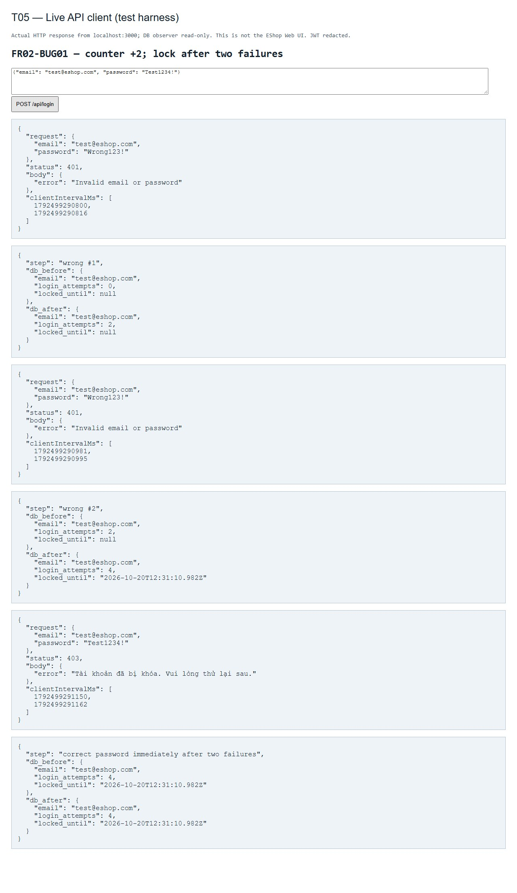

**GitHub:** [21](https://github.com/tranquocvy/eshop-sut/issues/21); Đã mở trang issue, kiểm tra tiêu đề/nội dung và ảnh bug tải hoàn tất.
Ảnh trang issue chụp 2026-10-20T19:31:13+07:00:
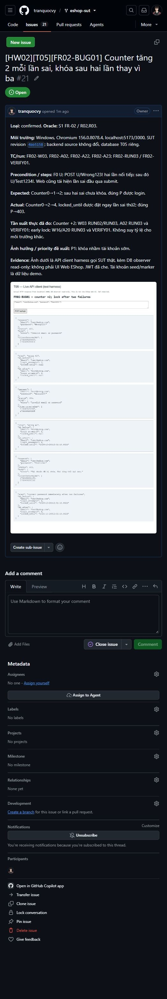

### FR02-BUG02 — Thời hạn khóa được đặt khoảng 180 giây, vẫn từ chối sau hơn31 giây

**Loại / oracle:** confirmed; S1 FR-02 / R04. **Ảnh hưởng:** P1: người dùng bị khóa lâu hơn yêu cầu.
**Môi trường:** revision4bb5158, Windows, source không đổi, Chromium/API ở trên. **TC:** Supplementary VERIFY01; TC exact-boundary vẫn blocked.
**Precondition và steps:** F0; gửi hai sai để tái hiện khóa thực tế; ghi bracket request kích hoạt và DB deadline; đợi31s thật rồi gửi đúng P.
**Expected:** Khóa chỉ30s kể từ khi kích hoạt; sau31s đúng P được đăng nhập.
**Actual:** VERIFY01: deadline cách request kích hoạt khoảng180s; đúng P sau31s vẫn403. Không credit các điểm ±1ms blocked.
**Tần suất thực đã thử:** 1/1 sequence VERIFY01 đo thời lượng; timestamp/bracket trong supplementary.
**Evidence:** [log TC và VERIFY01](results.json); chụp 2026-10-20T19:28:42+07:00.
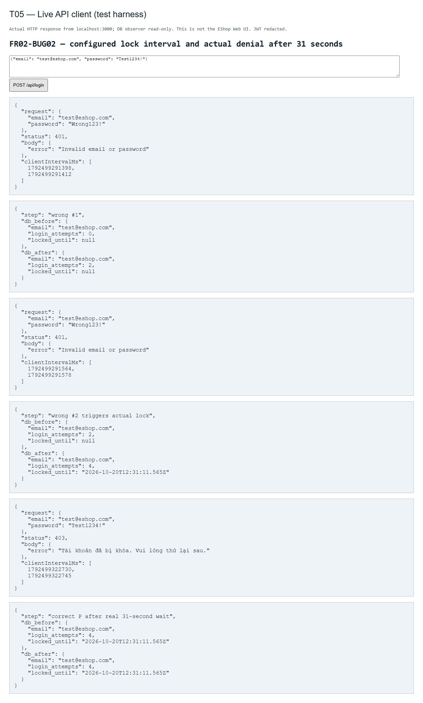

**GitHub:** [22](https://github.com/tranquocvy/eshop-sut/issues/22); Đã mở trang issue, đối chiếu tiêu đề/nội dung và ảnh bug hiển thị.
Ảnh trang issue chụp 2026-10-20T19:31:55+07:00:
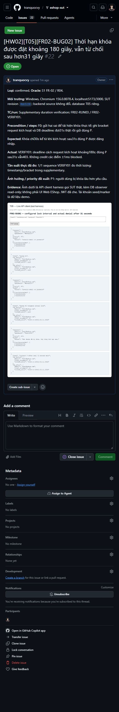

### FR02-BUG03 — Email Web dùng type=text, email sai vẫn gửi login request

**Loại / oracle:** confirmed; S1 FR-02 / R07. **Ảnh hưởng:** P2: thiếu validation HTML5 đã đặc tả.
**Môi trường:** revision4bb5158, Windows, source không đổi, Chromium/API ở trên. **TC:** FR02-W07, FR02-W08.
**Precondition và steps:** Mở /login; nhập plainaddress hoặc a@ cùng Test1234!, bấm Sign In; kiểm tra DOM và network.
**Expected:** type=email, HTML5 chặn email sai trước khi gửi login request.
**Actual:** type=text, validity=true; cả hai input phát POST /api/login, server401.
**Tần suất thực đã thử:** 2/2 input đã thử trong RUN03; không quy thành tỷ lệ mọi email.
**Evidence:** [log TC và VERIFY01](results.json); chụp 2026-10-20T19:26:45+07:00.
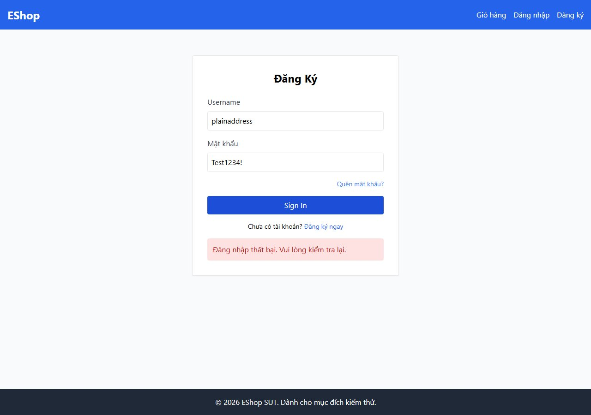

**GitHub:** [23](https://github.com/tranquocvy/eshop-sut/issues/23); Đã mở trang issue, đối chiếu tiêu đề/nội dung và ảnh bug hiển thị.
Ảnh trang issue chụp 2026-10-20T19:32:22+07:00:
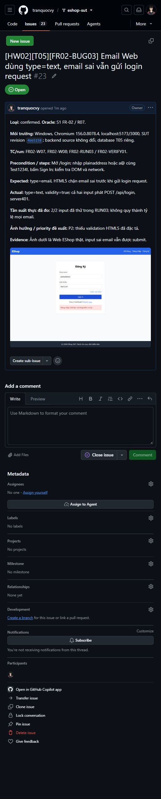

### FR02-BUG04 — [A02] Password thiếu/rỗng/null/object vẫn làm tăng counter tài khoản

**Loại / oracle:** assumption; A02 đề xuất; API §1.2 không chốt validation/counter invalid payload. **Ảnh hưởng:** P2 đề xuất: invalid request có thể gây khóa; cần chốt policy.
**Môi trường:** revision4bb5158, Windows, source không đổi, Chromium/API ở trên. **TC:** FR02-A13, FR02-A15, FR02-A17, FR02-A19.
**Precondition và steps:** Mỗi payload từ F0 riêng: email U và password absent, chuỗi rỗng, null, hoặc object {value:Test1234!}; POST /api/login.
**Expected:** Theo A02: từ chối có kiểm soát, counter không đổi; chưa phải requirement xác nhận.
**Actual:** Đều401 nhưng counter0→2. Bản thiếu password được tái hiện trong VERIFY01.
**Tần suất thực đã thử:** 4/4 biến thể RUN03; biến thể absent thêm1 lượt VERIFY01.
**Evidence:** [log TC và VERIFY01](results.json); chụp 2026-10-20T19:28:43+07:00.
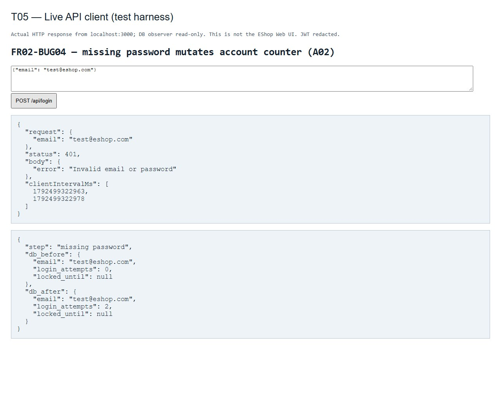

**GitHub:** [24](https://github.com/tranquocvy/eshop-sut/issues/24); Đã mở trang issue, đối chiếu tiêu đề/nội dung và ảnh bug hiển thị.
Ảnh trang issue chụp 2026-10-20T19:32:54+07:00:
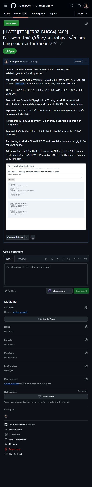

### FR02-BUG05 — [A04] Login response lộ password và reset_token trong user

**Loại / oracle:** assumption; A04 đề xuất; S2 cho user nhưng chưa mô tả field nhạy cảm. **Ảnh hưởng:** P1 đề xuất: lộ credential/reset marker; finding bảo mật theo A04.
**Môi trường:** revision4bb5158, Windows, source không đổi, Chromium/API ở trên. **TC:** FR02-A25.
**Precondition và steps:** F0; đặt marker reset_token=FR02_PRIVATE qua fixture; POST U/Test1234!, inspect JSON user.
**Expected:** Theo A04: token/user cần thiết, không password/reset_token.
**Actual:** 200 trả user.password=Test1234! và user.reset_token=FR02_PRIVATE; JWT đã che trong evidence.
**Tần suất thực đã thử:** 2/2 lượt A25 RUN03 và VERIFY01.
**Evidence:** [log TC và VERIFY01](results.json); chụp 2026-10-20T19:28:43+07:00.
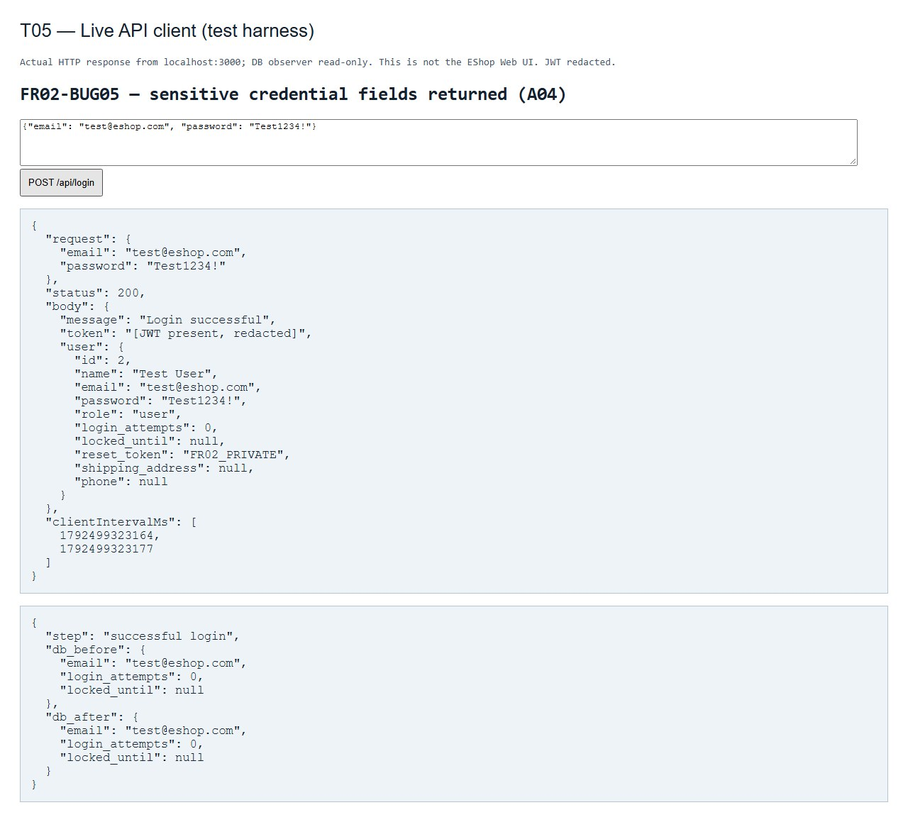

**GitHub:** [25](https://github.com/tranquocvy/eshop-sut/issues/25); Đã mở trang issue, đối chiếu tiêu đề/nội dung và ảnh bug hiển thị.
Ảnh trang issue chụp 2026-10-20T19:33:24+07:00:
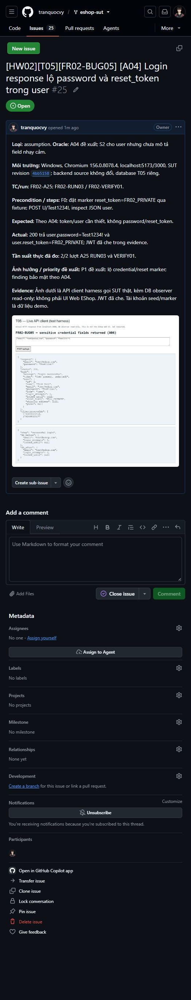

### FR02-BUG06 — [A01] Counter của khóa đã hết được dùng lại, lần sai đầu tái khóa

**Loại / oracle:** assumption; A01 đề xuất reset chuỗi sau hết khóa; S1 chưa quy định reset storage. **Ảnh hưởng:** P2 đề xuất: tái khóa sau expiry; cần chốt policy.
**Môi trường:** revision4bb5158, Windows, source không đổi, Chromium/API ở trên. **TC:** FR02-A11.
**Precondition và steps:** FL trực tiếp n=3, deadline=t0+30s; đợi31s thật; gửi U/Z hai lần rồi U/P. VERIFY01 cô lập lại với FL đã hết1s.
**Expected:** Theo A01: lần sai đầu chuỗi mới n=1, lần2 n=2 chưa khóa; đúng P thành công.
**Actual:** Sai đầu dùng n=3 cũ thành5 và khóa180s; hai request sau403. Increment+2 là BUG01; việc dùng counter cũ là finding riêng.
**Tần suất thực đã thử:** A11 RUN03 với wait31s và VERIFY01 expired fixture; 2 lượt.
**Evidence:** [log TC và VERIFY01](results.json); chụp 2026-10-20T19:28:43+07:00.
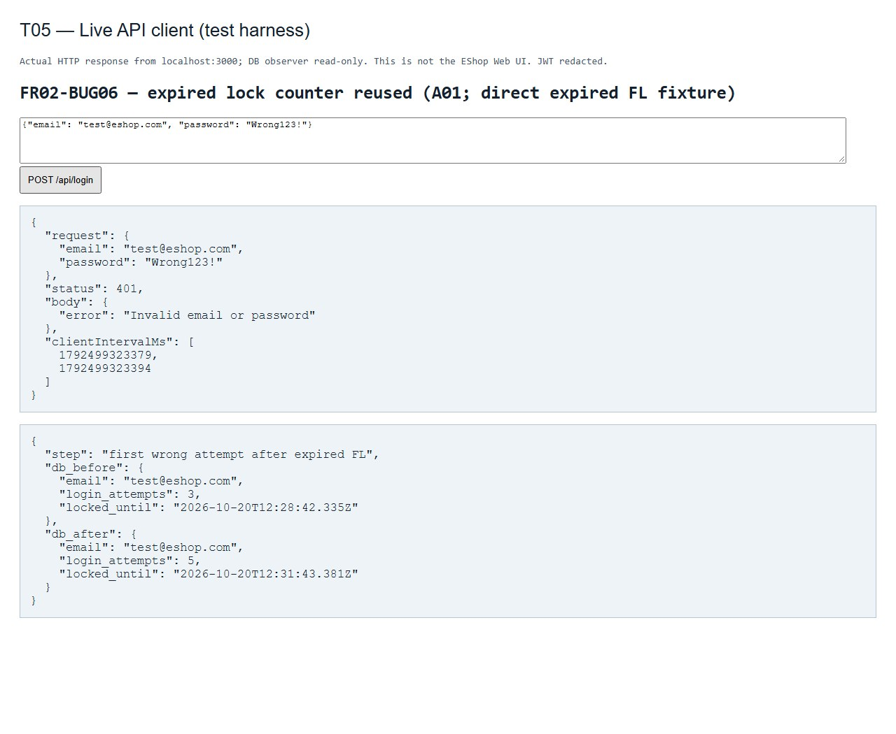

**GitHub:** [26](https://github.com/tranquocvy/eshop-sut/issues/26); Đã mở trang issue, đối chiếu tiêu đề/nội dung và ảnh bug hiển thị.
Ảnh trang issue chụp 2026-10-20T19:34:09+07:00:
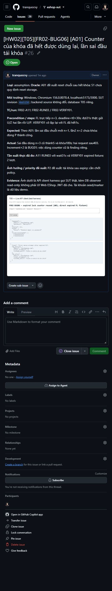

## Coverage và giới hạn

- Thiết kế: 13/13 mục tiêu miền và 6/6 boundary items/lớp theo inventory đã công bố; đây không phải coverage runtime.
- Exercise miền theo target: D01–D07, D09–D12 = 11/13; D08 chưa tới success để thử chuỗi mới, D13 không đạt F1 để thử concurrency. D07 mới exercise A11 theo FL trực tiếp; chưa đạt điểm thời gian sát30s.
- BVA catalogue: 0/6 item cho Web và 0/6 cho API được thực hiện đầy đủ đúng precondition/timing của TC. Các ca ngưỡng2/3/4 bị Fn sai chặn; sáu ca±1ms bị thiếu server clock/trace. VERIFY01 quan sát khóa thực tế sau hai sai nhưng không đổi blocked của TC đã duyệt.
- Duration supplementary: dùng bracket request thực kích hoạt khóa và stored deadline để suy khoảng180s; request đúng P sau hơn31s vẫn bị403. Không dùng sleep31s để nhận đã đạt equality30s. FL ở W11/A06 dùng mốc10s nominal, không claim chính xác10.000s.
- Counter observation đọc sau response+60ms API / khoảng250ms UI; đây là delay quan sát, không phải SLA của SUT. State counter2/4/5 được xác minh lại ở các sequence độc lập; không suy bug từ một lần đọc quá sớm.
- Những phần chưa chạy đủ: success-reset sequence, concurrency và BVA sát30s. Khi SUT sửa counter hoặc có clock control, rerun đúng ID với run ID mới. Không sửa SUT/expected để làm xanh.

## AI gaps và kiểm tra quy trình

| Loại | Nguồn / tác động | Xử lý |
| --- | --- | --- |
| Execution gap — locator W01 | RUN01 dùng accessible name Hồ sơ, nhưng UI link là Chào,…; timeout trước target profile. | Sửa locator href /profile, đọc email từ disabled input; RUN02/RUN03 W01 passed. Giữ RUN01 blocked. |
| Harness output | RUN02 stdout cp1252 lỗi khi in → sau khi đã lưu W03. | Cấu hình UTF-8; RUN03 chạy đủ catalogue, history không ghi đè. |
| Khả thi timing | Bản đầu đã nêu cần clock/trace; môi trường thực thiếu control±1ms. | Giữ sáu TC blocked, dùng measurement bổ trợ riêng; không nhận là case gap mới. |
| Model/case/oracle review | Đối chiếu v0.1 được duyệt và kết quả; chưa xác định thêm case gap hoặc oracle error trong phạm vi đã exercise. Counter/duration là nghi vấn đã biết từ thiết kế, không kể là bug AI bỏ sót. | Giữ assumption riêng; các miền bị chặn chưa đủ cơ sở kết luận coverage đầy đủ. |

Các lỗi mô tả trạng thái review thiết kế đã được sửa theo phản hồi thật của Vỹ trước run (commit4bb5158). Trạng thái review report lấy từ lời xác nhận thực tế của Vỹ; không suy sinh viên tự chạy test. Lượt execution không tự cập nhật AI Audit/Prompt Log, commit/push hoặc quay/upload demo; hồ sơ AI được cập nhật ở lượt riêng khi Vỹ giao.
