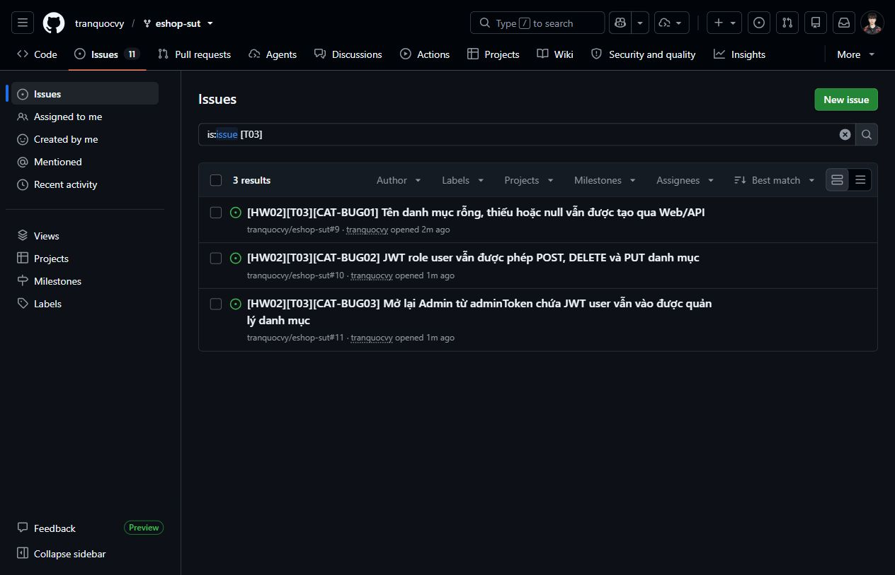
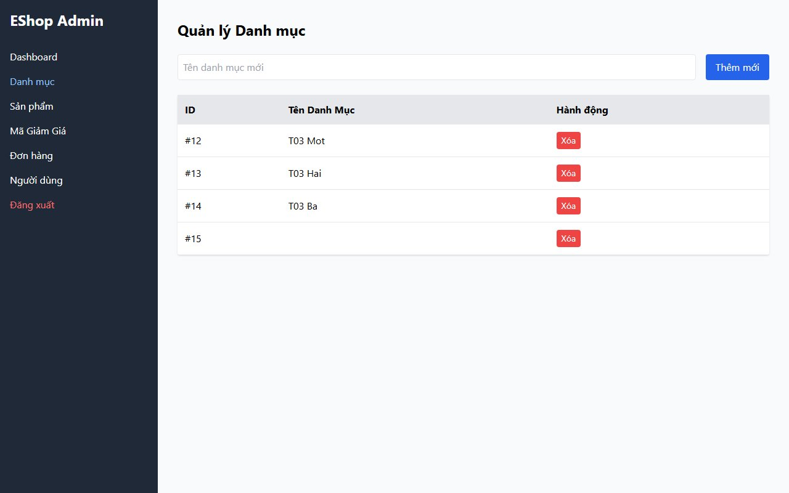
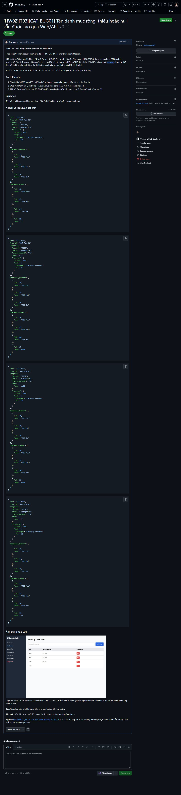
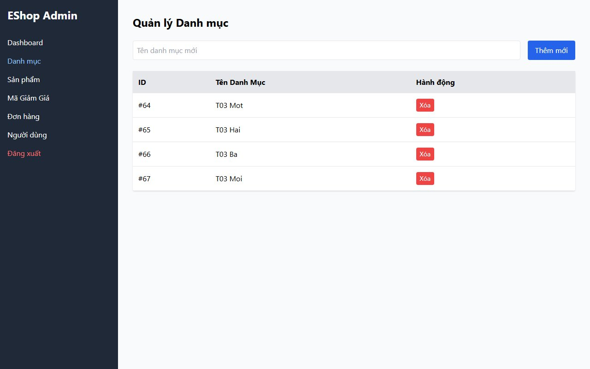
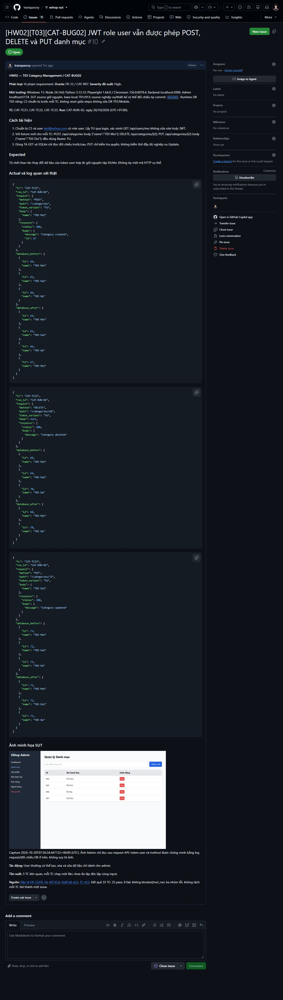
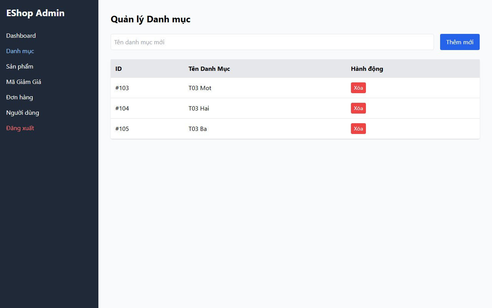
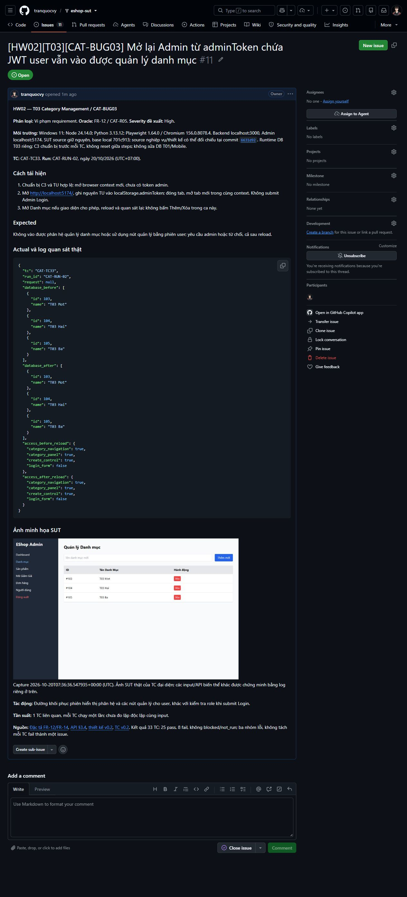

# Báo cáo kiểm thử T03 — Category Management

**HW02 — Trần Quốc Vỹ — 23120410.** Codex thực thi; kết quả chưa ghi nhận sinh viên nghiệm thu.

## 1. Phạm vi và môi trường

[Design](design.md) / [33 TC](test-cases.md) v0.2 tại `b84417b`; input, expected và ID giữ nguyên. Web Admin 12 TC, API 21 TC. PUT chỉ kiểm tra quyền, không đánh giá nghiệp vụ Update. Không thêm ca theo skill thiết kế mới trong lượt execution này.

SUT base `701c913`; backend server.js/database.js sao chép nguyên byte vào runtime T03 riêng; Admin dùng nguyên source repo. Windows 11, Node 24.14.0, Python 3.13.12, Playwright 1.64.0 / Chromium 156.0.8078.4. Admin `http://localhost:5174/`; API `http://localhost:3000/api`. Hash source/harness và môi trường ở `runs[]` trong [results.json](results.json).

C0/C1/C3 được chuẩn bị ngoài bước đang đánh giá, chỉ trong database runtime T03 mới; không reset DB repo/T01/Mobile. Xóa seed sản phẩm/danh mục chỉ ở runtime mới để tạo fixture không có tham chiếu, không đổi tài khoản/role. Không reset giữa các bước một TC. Runner đọc SQLite bằng mode=ro/query_only; API/DB không thay thao tác Web.

- `CAT-RUN-01`: 14:35:46 20/10/2026 (UTC+07:00) → 14:35:47 20/10/2026 (UTC+07:00); 1 TC; finished_selected_cases.
- `CAT-RUN-02`: 14:36:24 20/10/2026 (UTC+07:00) → 14:36:36 20/10/2026 (UTC+07:00); 32 TC; finished_selected_cases.

TC01 có cảnh báo `Target closed` lúc đóng browser sau khi đã quan sát xong; bỏ lệnh Response.finished thừa trước RUN02, vẫn đọc body thật bằng json/text và giữ toàn bộ actual. RUN02 hoàn tất 32 TC, không có lỗi harness/blocked hoặc tự gửi lại mutation. Runner được bổ sung ghi body API và JPG cho ca fail; không đổi SUT/oracle.

## 2. Kết quả và evidence từng TC

**33 TC: 25 passed, 8 failed, 0 blocked, 0 not_run.** Executed = 33/33; pass rate = 75,76%. Đếm unique TC theo `selected_results`; lịch sử trong `cases[].results`. Thiết kế vẫn giữ Not Run tại thời điểm thiết kế, kết quả hiện hành ở đây.

**Coverage đã exercise:** 7/7 rules, 19/19 mục tiêu miền, 6/6 BVA items; 15/15 tổ hợp token/method âm đã gửi/quan sát. Đây là coverage trên inventory đã duyệt, không phải 100% mọi hành vi hay 100% đúng. Các ca fail vẫn đi tới input/state mục tiêu.

Mỗi dòng có link **Log** tới trích đoạn có anchor ở §5, đúng TC/run và dữ liệu thật; từ đó có link JSON gốc cùng vị trí entry. Ảnh JPG chỉ thêm cho ca có ảnh của chính TC/run. JSON không bị gắn fragment TC giả.

**Đọc log:** `target_request` ghi method/path/body/biến thể token và response; `database_before/after` và `api_before/after` là tập ID/tên thực; `ui_before/ui_after_reload` là quan sát browser. `access_*` ghi màn hình/nút thực nhìn thấy. Token và mật khẩu thật không lưu trong log. `reason` là điều kiện đầu tiên không đạt; không có nghĩa các assertion phía sau lỗi đều đã được đánh giá. Thời gian JSON là UTC (+00:00), caption cộng 7 giờ.

### A. Web Admin

| TC | Input / kiểm tra | Mong đợi | Quan sát thực tế | Kết luận | Log / ảnh |
| --- | --- | --- | --- | --- | --- |
| [CAT-TC01](test-cases.md) | View danh sách rỗng | Không có dòng danh mục, không giữ dữ liệu cũ hoặc báo lỗi tải chỉ vì danh sách rỗng. R01/S1, GET S3 | UI trước/sau reload đủ 0 cặp ID/tên, khớp API/DB; dữ liệu giữ nguyên | Đạt (passed) | [Log CAT-TC01 / CAT-RUN-01](#log-cat-tc01) |
| [CAT-TC02](test-cases.md) | View danh mục `i1, T03 Mot` | Hiển thị đúng một danh mục với tên tương ứng; reload vẫn đúng C1. R01/S1 | UI trước/sau reload đủ 1 cặp ID/tên, khớp API/DB; dữ liệu giữ nguyên | Đạt (passed) | [Log CAT-TC02 / CAT-RUN-02](#log-cat-tc02) |
| [CAT-TC03](test-cases.md) | View ba danh mục fixture | Đủ ba ID/tên đúng cặp, không thiếu/nhân đôi dòng, không áp thứ tự. R01/S1 | UI trước/sau reload đủ 3 cặp ID/tên, khớp API/DB; dữ liệu giữ nguyên | Đạt (passed) | [Log CAT-TC03 / CAT-RUN-02](#log-cat-tc03) |
| [CAT-TC04](test-cases.md) | N=`Đồ học tập T03` | ADD-OK; tên tiếng Việt hiển thị đúng sau reload. R02/S1; A02; token admin theo S2 | HTTP 200; danh mục 3→4; thêm [{"id":11,"name":"Đồ học tập T03"}]; UI sau thao tác/reload khớp dữ liệu | Đạt (passed) | [Log CAT-TC04 / CAT-RUN-02](#log-cat-tc04) |
| [CAT-TC05](test-cases.md) | N=`""`, L=0 | NAME-REJECT; biên dưới không hợp lệ. R03/S1 | HTTP 200; danh mục 3→4; thêm [{"id":15,"name":""}]; UI sau thao tác/reload khớp dữ liệu | Không đạt (failed); [CAT-BUG01](#cat-bug01) | [Log CAT-TC05 / CAT-RUN-02](#log-cat-tc05); [JPG](images/CAT-TC05-actual.jpg) |
| [CAT-TC06](test-cases.md) | N=`A`, L=1 | ADD-OK; một ký tự đã thỏa nonempty, không tự đặt min 2. R02–03/S1, A02 | HTTP 200; danh mục 3→4; thêm [{"id":19,"name":"A"}]; UI sau thao tác/reload khớp dữ liệu | Đạt (passed) | [Log CAT-TC06 / CAT-RUN-02](#log-cat-tc06) |
| [CAT-TC07](test-cases.md) | N=`AB`, L=2 | ADD-OK; hàng xóm hợp lệ phía trên biên 1. R02–03/S1, A02 | HTTP 200; danh mục 3→4; thêm [{"id":23,"name":"AB"}]; UI sau thao tác/reload khớp dữ liệu | Đạt (passed) | [Log CAT-TC07 / CAT-RUN-02](#log-cat-tc07) |
| [CAT-TC11](test-cases.md) | Xóa `i2` (`T03 Hai`) | Chỉ i2 biến mất, i1/i3 và tên tương ứng giữ nguyên sau reload. R04/S1; path theo ID S3 | HTTP 200; danh mục 3→2; xóa [{"id":37,"name":"T03 Hai"}]; UI sau thao tác/reload khớp dữ liệu | Đạt (passed) | [Log CAT-TC11 / CAT-RUN-02](#log-cat-tc11) |
| [CAT-TC12](test-cases.md) | Xóa danh mục cuối `i1` | i1 bị xóa; danh sách rỗng sau reload, không còn dòng cũ. R01,R04/S1 | HTTP 200; danh mục 1→0; xóa [{"id":39,"name":"T03 Mot"}]; UI sau thao tác/reload khớp dữ liệu | Đạt (passed) | [Log CAT-TC12 / CAT-RUN-02](#log-cat-tc12) |
| [CAT-TC13](test-cases.md) | Guest mở `http://localhost:5174/` | Không truy cập được màn hình quản lý danh mục/nút thao tác quản lý trong phân hệ Admin; có yêu cầu xác thực hoặc từ chối. Không áp một URL redirect cụ thể. R05/S2 | Bị chặn trước và sau reload; hiện Login/yêu cầu admin; dữ liệu giữ nguyên | Đạt (passed) | [Log CAT-TC13 / CAT-RUN-02](#log-cat-tc13) |
| [CAT-TC14](test-cases.md) | Email `test@eshop.com`, password `Test1234!` tại Admin Login | User thường không vào được phân hệ quản lý danh mục dù thông tin đăng nhập hợp lệ. Không đòi exact alert. R05/S2; identity là setup, không kiểm thử lockout FR-02 | Bị chặn trước và sau reload; hiện Login/yêu cầu admin; dữ liệu giữ nguyên | Đạt (passed) | [Log CAT-TC14 / CAT-RUN-02](#log-cat-tc14) |
| [CAT-TC33](test-cases.md) | `localStorage` key `adminToken` chứa nguyên TU, không sửa payload | Không vào được phân hệ quản lý danh mục hoặc sử dụng nút quản lý với phiên user; phải yêu cầu tài khoản admin hoặc từ chối. Danh mục không đổi. Chỉ có response API bị chặn nhưng màn hình quản lý vẫn sử dụng được thì chưa đáp ứng oracle Web. Không yêu cầu xóa key/redirect cụ thể. R05/S2; key/điểm vào theo S4 | Vào được Danh mục, có nút Thêm mới trước/sau reload; không hiện Login; dữ liệu giữ nguyên | Không đạt (failed); [CAT-BUG03](#cat-bug03) | [Log CAT-TC33 / CAT-RUN-02](#log-cat-tc33); [JPG](images/CAT-TC33-actual.jpg) |

### B. API tên, BVA và ID vắng

| TC | Input / kiểm tra | Mong đợi | Quan sát thực tế | Kết luận | Log / ảnh |
| --- | --- | --- | --- | --- | --- |
| [CAT-TC08](test-cases.md) | POST `/api/categories`; `Authorization: Bearer &lt;TA>`; body `{}` | NAME-REJECT; không có name vẫn vi phạm required dù JSON hợp lệ. R03/S1; body S3 | HTTP 200; danh mục 3→4; thêm [{"id":27,"name":null}] | Không đạt (failed); [CAT-BUG01](#cat-bug01) | [Log CAT-TC08 / CAT-RUN-02](#log-cat-tc08); [JPG](images/CAT-TC08-actual.jpg) |
| [CAT-TC09](test-cases.md) | POST `/api/categories`; `Authorization: Bearer &lt;TA>`; body `{"name":null}` | NAME-REJECT; null không cung cấp một tên. R03/S1 | HTTP 200; danh mục 3→4; thêm [{"id":31,"name":null}] | Không đạt (failed); [CAT-BUG01](#cat-bug01) | [Log CAT-TC09 / CAT-RUN-02](#log-cat-tc09); [JPG](images/CAT-TC09-actual.jpg) |
| [CAT-TC10](test-cases.md) | POST `/api/categories`; `Authorization: Bearer &lt;TA>`; body `{"name":""}` | NAME-REJECT ở server; không credit từ việc TC05 bị UI chặn. R03/S1 | HTTP 200; danh mục 3→4; thêm [{"id":35,"name":""}] | Không đạt (failed); [CAT-BUG01](#cat-bug01) | [Log CAT-TC10 / CAT-RUN-02](#log-cat-tc10); [JPG](images/CAT-TC10-actual.jpg) |
| [CAT-TC24](test-cases.md) | DELETE `/api/categories/999999`; `Authorization: Bearer &lt;TA>`; không body | Không xóa/đổi i1/i2/i3 hoặc tạo danh mục mới. Chỉ đánh giá invariant theo ID của R04/S3; status/message/idempotency chưa có oracle (Q05) | HTTP 200; tập ID/tên giữ nguyên | Đạt (passed) | [Log CAT-TC24 / CAT-RUN-02](#log-cat-tc24) |
| [CAT-TC25](test-cases.md) | POST `/api/categories`; `Authorization: Bearer &lt;TA>`; body `{"name":"A"}`, L=1 | ADD-OK ở API; thêm đúng một tên `A`, danh mục cũ giữ nguyên. Tại L=1 phải chấp nhận. R02–03/S1, S3, A02 | HTTP 200; danh mục 3→4; thêm [{"id":80,"name":"A"}] | Đạt (passed) | [Log CAT-TC25 / CAT-RUN-02](#log-cat-tc25) |
| [CAT-TC26](test-cases.md) | POST `/api/categories`; `Authorization: Bearer &lt;TA>`; body `{"name":"AB"}`, L=2 | ADD-OK ở API; thêm đúng một tên `AB`, danh mục cũ giữ nguyên. Hàng xóm hợp lệ phía trên biên. R02–03/S1, S3, A02 | HTTP 200; danh mục 3→4; thêm [{"id":84,"name":"AB"}] | Đạt (passed) | [Log CAT-TC26 / CAT-RUN-02](#log-cat-tc26) |

### C. API xác thực và quyền

| TC | Input / kiểm tra | Mong đợi | Quan sát thực tế | Kết luận | Log / ảnh |
| --- | --- | --- | --- | --- | --- |
| [CAT-TC15](test-cases.md) | POST `/api/categories`; body `{"name":"T03 Moi"}` | AUTH-REJECT; không thêm `T03 Moi`. R06/S2 | HTTP 401; tập ID/tên giữ nguyên | Đạt (passed) | [Log CAT-TC15 / CAT-RUN-02](#log-cat-tc15) |
| [CAT-TC16](test-cases.md) | DELETE `/api/categories/&lt;i2>`; không body | AUTH-REJECT; i2 vẫn tồn tại, tên cũ giữ nguyên. R06/S2 | HTTP 401; tập ID/tên giữ nguyên | Đạt (passed) | [Log CAT-TC16 / CAT-RUN-02](#log-cat-tc16) |
| [CAT-TC17](test-cases.md) | PUT `/api/categories/&lt;i2>`; body `{"name":"T03 Doi"}` | AUTH-REJECT; i2 không bị đổi tên. Chỉ kiểm tra quyền PUT. R06/S2 | HTTP 401; tập ID/tên giữ nguyên | Đạt (passed) | [Log CAT-TC17 / CAT-RUN-02](#log-cat-tc17) |
| [CAT-TC18](test-cases.md) | POST `/api/categories`; body `{"name":"T03 Moi"}` | AUTH-REJECT; không thêm `T03 Moi`. R06/S2 | HTTP 403; tập ID/tên giữ nguyên | Đạt (passed) | [Log CAT-TC18 / CAT-RUN-02](#log-cat-tc18) |
| [CAT-TC19](test-cases.md) | DELETE `/api/categories/&lt;i2>`; không body | AUTH-REJECT; i2 không bị xóa. R06/S2 | HTTP 403; tập ID/tên giữ nguyên | Đạt (passed) | [Log CAT-TC19 / CAT-RUN-02](#log-cat-tc19) |
| [CAT-TC20](test-cases.md) | PUT `/api/categories/&lt;i2>`; body `{"name":"T03 Doi"}` | AUTH-REJECT; i2 không bị đổi tên. R06/S2 | HTTP 403; tập ID/tên giữ nguyên | Đạt (passed) | [Log CAT-TC20 / CAT-RUN-02](#log-cat-tc20) |
| [CAT-TC21](test-cases.md) | POST `/api/categories`; body `{"name":"T03 Moi"}` | AUTH-REJECT; không thêm `T03 Moi` dù token hợp lệ. R07/S2 | HTTP 200; danh mục 3→4; thêm [{"id":67,"name":"T03 Moi"}] | Không đạt (failed); [CAT-BUG02](#cat-bug02) | [Log CAT-TC21 / CAT-RUN-02](#log-cat-tc21); [JPG](images/CAT-TC21-actual.jpg) |
| [CAT-TC22](test-cases.md) | DELETE `/api/categories/&lt;i2>`; không body | AUTH-REJECT; i2 không bị xóa. R07/S2 | HTTP 200; danh mục 3→2; xóa [{"id":69,"name":"T03 Hai"}] | Không đạt (failed); [CAT-BUG02](#cat-bug02) | [Log CAT-TC22 / CAT-RUN-02](#log-cat-tc22); [JPG](images/CAT-TC22-actual.jpg) |
| [CAT-TC23](test-cases.md) | PUT `/api/categories/&lt;i2>`; body `{"name":"T03 Doi"}` | AUTH-REJECT; i2 không bị đổi tên. R07/S2 | HTTP 200; danh mục 3→3; đổi #72: T03 Hai→T03 Doi | Không đạt (failed); [CAT-BUG02](#cat-bug02) | [Log CAT-TC23 / CAT-RUN-02](#log-cat-tc23); [JPG](images/CAT-TC23-actual.jpg) |
| [CAT-TC27](test-cases.md) | POST `/api/categories`; `Authorization: Bearer &lt;TP>`; body `{"name":"T03 Moi"}` | AUTH-REJECT; không thêm `T03 Moi`, không tin role admin trong payload đã sửa. R06/S2 | HTTP 403; tập ID/tên giữ nguyên | Đạt (passed) | [Log CAT-TC27 / CAT-RUN-02](#log-cat-tc27) |
| [CAT-TC28](test-cases.md) | DELETE `/api/categories/&lt;i2>`; `Authorization: Bearer &lt;TP>`; không body | AUTH-REJECT; i2 không bị xóa, toàn bộ danh mục giữ nguyên. R06/S2 | HTTP 403; tập ID/tên giữ nguyên | Đạt (passed) | [Log CAT-TC28 / CAT-RUN-02](#log-cat-tc28) |
| [CAT-TC29](test-cases.md) | PUT `/api/categories/&lt;i2>`; `Authorization: Bearer &lt;TP>`; body `{"name":"T03 Doi"}` | AUTH-REJECT; i2 không bị đổi tên. Chỉ kiểm tra xác thực PUT. R06/S2 | HTTP 403; tập ID/tên giữ nguyên | Đạt (passed) | [Log CAT-TC29 / CAT-RUN-02](#log-cat-tc29) |
| [CAT-TC30](test-cases.md) | POST `/api/categories`; `Authorization: Bearer &lt;TS>`; body `{"name":"T03 Moi"}` | AUTH-REJECT; không thêm `T03 Moi` dù payload vẫn ghi admin. R06/S2 | HTTP 403; tập ID/tên giữ nguyên | Đạt (passed) | [Log CAT-TC30 / CAT-RUN-02](#log-cat-tc30) |
| [CAT-TC31](test-cases.md) | DELETE `/api/categories/&lt;i2>`; `Authorization: Bearer &lt;TS>`; không body | AUTH-REJECT; i2 không bị xóa, toàn bộ danh mục giữ nguyên. R06/S2 | HTTP 403; tập ID/tên giữ nguyên | Đạt (passed) | [Log CAT-TC31 / CAT-RUN-02](#log-cat-tc31) |
| [CAT-TC32](test-cases.md) | PUT `/api/categories/&lt;i2>`; `Authorization: Bearer &lt;TS>`; body `{"name":"T03 Doi"}` | AUTH-REJECT; i2 không bị đổi tên. Chỉ kiểm tra xác thực PUT. R06/S2 | HTTP 403; tập ID/tên giữ nguyên | Đạt (passed) | [Log CAT-TC32 / CAT-RUN-02](#log-cat-tc32) |

## 3. Bugs và hồ sơ GitHub

Đã đăng và mở kiểm tra 3 issue: [#9](https://github.com/tranquocvy/eshop-sut/issues/9), [#10](https://github.com/tranquocvy/eshop-sut/issues/10), [#11](https://github.com/tranquocvy/eshop-sut/issues/11). Mỗi issue có ảnh SUT đính kèm và JPG trang issue riêng.



*Ảnh danh sách GitHub thật, capture 2026-10-20T07:45:08.895Z (UTC); ảnh từng issue và giờ UTC+07 nằm trong từng bug.*

Ba nhóm đều vi phạm requirement xác nhận, không phải quy ước mới. Mức ảnh hưởng là đề xuất. Tần suất tính theo TC thực đã chạy, không tự nhận 3/3 hay 5/5 lần lặp cùng input.

<a id="cat-bug01"></a>

### CAT-BUG01 — Tên danh mục rỗng, thiếu hoặc null vẫn được tạo qua Web/API

**Oracle:** FR-14 / CAT-R03. **Severity đề xuất:** Medium. **TC:** CAT-TC05, CAT-TC08, CAT-TC09, CAT-TC10.

**Precondition/steps:**

1. Chuẩn bị C3 (T03 Mot/T03 Hai/T03 Ba), không có sản phẩm tham chiếu; đăng nhập Admin.
2. Web: mở Danh mục, để trống Tên danh mục mới, bấm Thêm mới một lần rồi reload.
3. API: với fixture mới cho mỗi TC, POST /api/categories bằng TA, lần lượt body {}, {"name":null}, {"name":""}.

**Expected:** Từ chối tên không có giá trị; có phản hồi thất bại/validation và giữ nguyên danh mục.

**Actual:**

- [CAT-TC05](#log-cat-tc05): HTTP 200; danh mục 3→4; thêm [{"id":15,"name":""}]; UI sau thao tác/reload khớp dữ liệu

- [CAT-TC08](#log-cat-tc08): HTTP 200; danh mục 3→4; thêm [{"id":27,"name":null}]

- [CAT-TC09](#log-cat-tc09): HTTP 200; danh mục 3→4; thêm [{"id":31,"name":null}]

- [CAT-TC10](#log-cat-tc10): HTTP 200; danh mục 3→4; thêm [{"id":35,"name":""}]

**Tác động:** Tạo bản ghi không có tên, vi phạm trường tên bắt buộc.

**Tần suất:** 4 TC liên quan, mỗi TC chạy một lần; chưa đo lặp độc lập cùng input.



*CAT-TC05 / CAT-RUN-02; chụp 14:36:27 20/10/2026 (UTC+07:00). Ảnh màn hình SUT thật; persistence đối chiếu thêm API/DB.*

**GitHub:** [https://github.com/tranquocvy/eshop-sut/issues/9](https://github.com/tranquocvy/eshop-sut/issues/9) — Open — đã mở trang, kiểm tra ảnh SUT hiển thị và lưu JPG trang issue



*Ảnh trang GitHub issue thật; chụp 14:43:49 20/10/2026 (UTC+07:00); tách khỏi thời gian capture SUT.*

<a id="cat-bug02"></a>

### CAT-BUG02 — JWT role user vẫn được phép POST, DELETE và PUT danh mục

**Oracle:** FR-12 / CAT-R07. **Severity đề xuất:** High. **TC:** CAT-TC21, CAT-TC22, CAT-TC23.

**Precondition/steps:**

1. Chuẩn bị C3 và user test@eshop.com có role user. Lấy TU qua login, xác minh GET /api/users/me; không sửa role hoặc JWT.
2. Với fixture mới cho mỗi TC: POST /api/categories body {"name":"T03 Moi"}; DELETE /api/categories/{i2}; PUT /api/categories/{i2} body {"name":"T03 Doi"}; đều dùng Bearer TU.
3. Dùng TA GET và SQLite chỉ đọc đối chiếu trước/sau. PUT chỉ kiểm tra quyền, không kiểm thử đầy đủ nghiệp vụ Update.

**Expected:** Từ chối thao tác thay đổi dữ liệu của token user hợp lệ; giữ nguyên tập ID/tên. Không ép một mã HTTP cụ thể.

**Actual:**

- [CAT-TC21](#log-cat-tc21): HTTP 200; danh mục 3→4; thêm [{"id":67,"name":"T03 Moi"}]

- [CAT-TC22](#log-cat-tc22): HTTP 200; danh mục 3→2; xóa [{"id":69,"name":"T03 Hai"}]

- [CAT-TC23](#log-cat-tc23): HTTP 200; danh mục 3→3; đổi #72: T03 Hai→T03 Doi

**Tác động:** User thường có thể tạo, xóa và sửa dữ liệu chỉ dành cho admin.

**Tần suất:** 3 TC liên quan, mỗi TC chạy một lần; chưa đo lặp độc lập cùng input.



*CAT-TC21 / CAT-RUN-02; chụp 14:36:34 20/10/2026 (UTC+07:00). Ảnh là Admin view chỉ đọc sau request API; token user/method và dữ liệu trước–sau phải đối chiếu log, không suy từ ảnh.*

**GitHub:** [https://github.com/tranquocvy/eshop-sut/issues/10](https://github.com/tranquocvy/eshop-sut/issues/10) — Open — đã mở trang, kiểm tra ảnh SUT hiển thị và lưu JPG trang issue



*Ảnh trang GitHub issue thật; chụp 14:44:07 20/10/2026 (UTC+07:00); tách khỏi thời gian capture SUT.*

<a id="cat-bug03"></a>

### CAT-BUG03 — Mở lại Admin từ adminToken chứa JWT user vẫn vào được quản lý danh mục

**Oracle:** FR-12 / CAT-R05. **Severity đề xuất:** High. **TC:** CAT-TC33.

**Precondition/steps:**

1. Chuẩn bị C3 và TU hợp lệ; mở browser context mới, chưa có token admin.
2. Mở http://localhost:5174/, ghi nguyên TU vào localStorage.adminToken; đóng tab, mở tab mới trong cùng context. Không submit Admin Login.
3. Mở Danh mục nếu giao diện cho phép, reload và quan sát lại; không bấm Thêm/Xóa trong ca này.

**Expected:** Không vào được phân hệ quản lý danh mục hoặc sử dụng nút quản lý bằng phiên user; yêu cầu admin hoặc từ chối, cả sau reload.

**Actual:**

- [CAT-TC33](#log-cat-tc33): Vào được Danh mục, có nút Thêm mới trước/sau reload; không hiện Login; dữ liệu giữ nguyên

**Tác động:** Đường khôi phục phiên hiển thị phân hệ và các nút quản lý cho user, khác với kiểm tra role khi submit Login.

**Tần suất:** 1 TC liên quan, mỗi TC chạy một lần; chưa đo lặp độc lập cùng input.



*CAT-TC33 / CAT-RUN-02; chụp 14:36:36 20/10/2026 (UTC+07:00). Ảnh màn hình SUT thật; persistence đối chiếu thêm API/DB.*

**GitHub:** [https://github.com/tranquocvy/eshop-sut/issues/11](https://github.com/tranquocvy/eshop-sut/issues/11) — Open — đã mở trang, kiểm tra ảnh SUT hiển thị và lưu JPG trang issue



*Ảnh trang GitHub issue thật; chụp 14:44:21 20/10/2026 (UTC+07:00); tách khỏi thời gian capture SUT.*

## 4. Kết luận và giới hạn

Toàn bộ 33 TC đã có verdict từ quan sát thực; không cần pass 100% để báo cáo trung thực. Các ca không/malformed JWT và JWT sửa payload/chữ ký từ chối, còn TU nguyên gốc làm thay đổi dữ liệu trái quyền; TC14 Admin Login chặn user nhưng TC33 khôi phục phiên user vẫn mở phân hệ. Các nhóm này giữ riêng để phân biệt entry Web với API.

Không sửa nghiệp vụ, không sinh thêm TC, không nhận đã kiểm thử Update đầy đủ; không ghi AI audit, commit/push hoặc tạo video trong lượt này. Chi tiết đăng/chụp issue nằm trong `bugs[].github_activity`; cả 3 issue đã xác minh ảnh SUT hiển thị và có JPG trang issue.

## 5. Trích log theo TC/run

Các trích đoạn dưới lấy từ observations thật, giúp bấm đúng TC để kiểm chứng. Bản đầy đủ và history ở [results.json](results.json); vị trí entry ghi theo chỉ số bắt đầu từ 0.

<a id="log-cat-tc01"></a>

### CAT-TC01 — CAT-RUN-01

[JSON gốc](results.json): `cases[0].results[0]`; 14:35:46 20/10/2026 (UTC+07:00) → 14:35:47 20/10/2026 (UTC+07:00); **passed**.

- UI trước/reload: `[]` → `[]`.
- DB trước → sau: `[]` → `[]`. API GET trước/sau khớp DB.

<a id="log-cat-tc02"></a>

### CAT-TC02 — CAT-RUN-02

[JSON gốc](results.json): `cases[1].results[0]`; 14:36:24 20/10/2026 (UTC+07:00) → 14:36:25 20/10/2026 (UTC+07:00); **passed**.

- UI trước/reload: `[{"id":4,"name":"T03 Mot"}]` → `[{"id":4,"name":"T03 Mot"}]`.
- DB trước → sau: `[{"id":4,"name":"T03 Mot"}]` → `[{"id":4,"name":"T03 Mot"}]`. API GET trước/sau khớp DB.

<a id="log-cat-tc03"></a>

### CAT-TC03 — CAT-RUN-02

[JSON gốc](results.json): `cases[2].results[0]`; 14:36:25 20/10/2026 (UTC+07:00) → 14:36:25 20/10/2026 (UTC+07:00); **passed**.

- UI trước/reload: `[{"id":5,"name":"T03 Mot"},{"id":6,"name":"T03 Hai"},{"id":7,"name":"T03 Ba"}]` → `[{"id":5,"name":"T03 Mot"},{"id":6,"name":"T03 Hai"},{"id":7,"name":"T03 Ba"}]`.
- DB trước → sau: `[{"id":5,"name":"T03 Mot"},{"id":6,"name":"T03 Hai"},{"id":7,"name":"T03 Ba"}]` → `[{"id":5,"name":"T03 Mot"},{"id":6,"name":"T03 Hai"},{"id":7,"name":"T03 Ba"}]`. API GET trước/sau khớp DB.

<a id="log-cat-tc04"></a>

### CAT-TC04 — CAT-RUN-02

[JSON gốc](results.json): `cases[3].results[0]`; 14:36:25 20/10/2026 (UTC+07:00) → 14:36:26 20/10/2026 (UTC+07:00); **passed**.

**Request/response thực:**

```json
{"method":"POST","path":"/categories","response":{"status":200,"body":{"message":"Category created","id":11}}}
```

- UI sau thao tác/reload: `[{"id":8,"name":"T03 Mot"},{"id":9,"name":"T03 Hai"},{"id":10,"name":"T03 Ba"},{"id":11,"name":"Đồ học tập T03"}]` → `[{"id":8,"name":"T03 Mot"},{"id":9,"name":"T03 Hai"},{"id":10,"name":"T03 Ba"},{"id":11,"name":"Đồ học tập T03"}]`.
- DB trước → sau: `[{"id":8,"name":"T03 Mot"},{"id":9,"name":"T03 Hai"},{"id":10,"name":"T03 Ba"}]` → `[{"id":8,"name":"T03 Mot"},{"id":9,"name":"T03 Hai"},{"id":10,"name":"T03 Ba"},{"id":11,"name":"Đồ học tập T03"}]`. API GET trước/sau khớp DB.

<a id="log-cat-tc05"></a>

### CAT-TC05 — CAT-RUN-02

[JSON gốc](results.json): `cases[4].results[0]`; 14:36:26 20/10/2026 (UTC+07:00) → 14:36:27 20/10/2026 (UTC+07:00); **failed**.

**Request/response thực:**

```json
{"method":"POST","path":"/categories","response":{"status":200,"body":{"message":"Category created","id":15}}}
```

- UI sau thao tác/reload: `[{"id":12,"name":"T03 Mot"},{"id":13,"name":"T03 Hai"},{"id":14,"name":"T03 Ba"},{"id":15,"name":""}]` → `[{"id":12,"name":"T03 Mot"},{"id":13,"name":"T03 Hai"},{"id":14,"name":"T03 Ba"},{"id":15,"name":""}]`.
- DB trước → sau: `[{"id":12,"name":"T03 Mot"},{"id":13,"name":"T03 Hai"},{"id":14,"name":"T03 Ba"}]` → `[{"id":12,"name":"T03 Mot"},{"id":13,"name":"T03 Hai"},{"id":14,"name":"T03 Ba"},{"id":15,"name":""}]`. API GET trước/sau khớp DB.
- Điều kiện không đạt: The category dataset changed unexpectedly.

<a id="log-cat-tc06"></a>

### CAT-TC06 — CAT-RUN-02

[JSON gốc](results.json): `cases[5].results[0]`; 14:36:27 20/10/2026 (UTC+07:00) → 14:36:28 20/10/2026 (UTC+07:00); **passed**.

**Request/response thực:**

```json
{"method":"POST","path":"/categories","response":{"status":200,"body":{"message":"Category created","id":19}}}
```

- UI sau thao tác/reload: `[{"id":16,"name":"T03 Mot"},{"id":17,"name":"T03 Hai"},{"id":18,"name":"T03 Ba"},{"id":19,"name":"A"}]` → `[{"id":16,"name":"T03 Mot"},{"id":17,"name":"T03 Hai"},{"id":18,"name":"T03 Ba"},{"id":19,"name":"A"}]`.
- DB trước → sau: `[{"id":16,"name":"T03 Mot"},{"id":17,"name":"T03 Hai"},{"id":18,"name":"T03 Ba"}]` → `[{"id":16,"name":"T03 Mot"},{"id":17,"name":"T03 Hai"},{"id":18,"name":"T03 Ba"},{"id":19,"name":"A"}]`. API GET trước/sau khớp DB.

<a id="log-cat-tc07"></a>

### CAT-TC07 — CAT-RUN-02

[JSON gốc](results.json): `cases[6].results[0]`; 14:36:28 20/10/2026 (UTC+07:00) → 14:36:29 20/10/2026 (UTC+07:00); **passed**.

**Request/response thực:**

```json
{"method":"POST","path":"/categories","response":{"status":200,"body":{"message":"Category created","id":23}}}
```

- UI sau thao tác/reload: `[{"id":20,"name":"T03 Mot"},{"id":21,"name":"T03 Hai"},{"id":22,"name":"T03 Ba"},{"id":23,"name":"AB"}]` → `[{"id":20,"name":"T03 Mot"},{"id":21,"name":"T03 Hai"},{"id":22,"name":"T03 Ba"},{"id":23,"name":"AB"}]`.
- DB trước → sau: `[{"id":20,"name":"T03 Mot"},{"id":21,"name":"T03 Hai"},{"id":22,"name":"T03 Ba"}]` → `[{"id":20,"name":"T03 Mot"},{"id":21,"name":"T03 Hai"},{"id":22,"name":"T03 Ba"},{"id":23,"name":"AB"}]`. API GET trước/sau khớp DB.

<a id="log-cat-tc08"></a>

### CAT-TC08 — CAT-RUN-02

[JSON gốc](results.json): `cases[7].results[0]`; 14:36:29 20/10/2026 (UTC+07:00) → 14:36:30 20/10/2026 (UTC+07:00); **failed**.

**Request/response thực:**

```json
{"method":"POST","path":"/categories","token_variant":"TA","body":{},"response":{"status":200,"body":{"message":"Category created","id":27}}}
```

- DB trước → sau: `[{"id":24,"name":"T03 Mot"},{"id":25,"name":"T03 Hai"},{"id":26,"name":"T03 Ba"}]` → `[{"id":24,"name":"T03 Mot"},{"id":25,"name":"T03 Hai"},{"id":26,"name":"T03 Ba"},{"id":27,"name":null}]`. API GET trước/sau khớp DB.
- Điều kiện không đạt: The category dataset changed unexpectedly.

<a id="log-cat-tc09"></a>

### CAT-TC09 — CAT-RUN-02

[JSON gốc](results.json): `cases[8].results[0]`; 14:36:30 20/10/2026 (UTC+07:00) → 14:36:30 20/10/2026 (UTC+07:00); **failed**.

**Request/response thực:**

```json
{"method":"POST","path":"/categories","token_variant":"TA","body":{"name":null},"response":{"status":200,"body":{"message":"Category created","id":31}}}
```

- DB trước → sau: `[{"id":28,"name":"T03 Mot"},{"id":29,"name":"T03 Hai"},{"id":30,"name":"T03 Ba"}]` → `[{"id":28,"name":"T03 Mot"},{"id":29,"name":"T03 Hai"},{"id":30,"name":"T03 Ba"},{"id":31,"name":null}]`. API GET trước/sau khớp DB.
- Điều kiện không đạt: The category dataset changed unexpectedly.

<a id="log-cat-tc10"></a>

### CAT-TC10 — CAT-RUN-02

[JSON gốc](results.json): `cases[9].results[0]`; 14:36:30 20/10/2026 (UTC+07:00) → 14:36:31 20/10/2026 (UTC+07:00); **failed**.

**Request/response thực:**

```json
{"method":"POST","path":"/categories","token_variant":"TA","body":{"name":""},"response":{"status":200,"body":{"message":"Category created","id":35}}}
```

- DB trước → sau: `[{"id":32,"name":"T03 Mot"},{"id":33,"name":"T03 Hai"},{"id":34,"name":"T03 Ba"}]` → `[{"id":32,"name":"T03 Mot"},{"id":33,"name":"T03 Hai"},{"id":34,"name":"T03 Ba"},{"id":35,"name":""}]`. API GET trước/sau khớp DB.
- Điều kiện không đạt: The category dataset changed unexpectedly.

<a id="log-cat-tc11"></a>

### CAT-TC11 — CAT-RUN-02

[JSON gốc](results.json): `cases[10].results[0]`; 14:36:31 20/10/2026 (UTC+07:00) → 14:36:32 20/10/2026 (UTC+07:00); **passed**.

**Request/response thực:**

```json
{"method":"DELETE","path":"/categories/37","response":{"status":200,"body":{"message":"Category deleted"}}}
```

- UI sau thao tác/reload: `[{"id":36,"name":"T03 Mot"},{"id":38,"name":"T03 Ba"}]` → `[{"id":36,"name":"T03 Mot"},{"id":38,"name":"T03 Ba"}]`.
- DB trước → sau: `[{"id":36,"name":"T03 Mot"},{"id":37,"name":"T03 Hai"},{"id":38,"name":"T03 Ba"}]` → `[{"id":36,"name":"T03 Mot"},{"id":38,"name":"T03 Ba"}]`. API GET trước/sau khớp DB.

<a id="log-cat-tc12"></a>

### CAT-TC12 — CAT-RUN-02

[JSON gốc](results.json): `cases[11].results[0]`; 14:36:32 20/10/2026 (UTC+07:00) → 14:36:33 20/10/2026 (UTC+07:00); **passed**.

**Request/response thực:**

```json
{"method":"DELETE","path":"/categories/39","response":{"status":200,"body":{"message":"Category deleted"}}}
```

- UI sau thao tác/reload: `[]` → `[]`.
- DB trước → sau: `[{"id":39,"name":"T03 Mot"}]` → `[]`. API GET trước/sau khớp DB.

<a id="log-cat-tc13"></a>

### CAT-TC13 — CAT-RUN-02

[JSON gốc](results.json): `cases[12].results[0]`; 14:36:33 20/10/2026 (UTC+07:00) → 14:36:33 20/10/2026 (UTC+07:00); **passed**.

- access_before_reload: `{"category_navigation":false,"category_panel":false,"create_control":false,"login_form":true}`.
- access_after_reload: `{"category_navigation":false,"category_panel":false,"create_control":false,"login_form":true}`.
- DB trước → sau: `[{"id":40,"name":"T03 Mot"},{"id":41,"name":"T03 Hai"},{"id":42,"name":"T03 Ba"}]` → `[{"id":40,"name":"T03 Mot"},{"id":41,"name":"T03 Hai"},{"id":42,"name":"T03 Ba"}]`. API GET trước/sau khớp DB.

<a id="log-cat-tc14"></a>

### CAT-TC14 — CAT-RUN-02

[JSON gốc](results.json): `cases[13].results[0]`; 14:36:33 20/10/2026 (UTC+07:00) → 14:36:33 20/10/2026 (UTC+07:00); **passed**.

- access_before_reload: `{"category_navigation":false,"category_panel":false,"create_control":false,"login_form":true}`.
- access_after_reload: `{"category_navigation":false,"category_panel":false,"create_control":false,"login_form":true}`.
- DB trước → sau: `[{"id":43,"name":"T03 Mot"},{"id":44,"name":"T03 Hai"},{"id":45,"name":"T03 Ba"}]` → `[{"id":43,"name":"T03 Mot"},{"id":44,"name":"T03 Hai"},{"id":45,"name":"T03 Ba"}]`. API GET trước/sau khớp DB.

<a id="log-cat-tc15"></a>

### CAT-TC15 — CAT-RUN-02

[JSON gốc](results.json): `cases[14].results[0]`; 14:36:33 20/10/2026 (UTC+07:00) → 14:36:33 20/10/2026 (UTC+07:00); **passed**.

**Request/response thực:**

```json
{"method":"POST","path":"/categories","token_variant":"none","body":{"name":"T03 Moi"},"response":{"status":401,"body":{"error":"Unauthorized"}}}
```

- DB trước → sau: `[{"id":46,"name":"T03 Mot"},{"id":47,"name":"T03 Hai"},{"id":48,"name":"T03 Ba"}]` → `[{"id":46,"name":"T03 Mot"},{"id":47,"name":"T03 Hai"},{"id":48,"name":"T03 Ba"}]`. API GET trước/sau khớp DB.

<a id="log-cat-tc16"></a>

### CAT-TC16 — CAT-RUN-02

[JSON gốc](results.json): `cases[15].results[0]`; 14:36:33 20/10/2026 (UTC+07:00) → 14:36:33 20/10/2026 (UTC+07:00); **passed**.

**Request/response thực:**

```json
{"method":"DELETE","path":"/categories/50","token_variant":"none","body":null,"response":{"status":401,"body":{"error":"Unauthorized"}}}
```

- DB trước → sau: `[{"id":49,"name":"T03 Mot"},{"id":50,"name":"T03 Hai"},{"id":51,"name":"T03 Ba"}]` → `[{"id":49,"name":"T03 Mot"},{"id":50,"name":"T03 Hai"},{"id":51,"name":"T03 Ba"}]`. API GET trước/sau khớp DB.

<a id="log-cat-tc17"></a>

### CAT-TC17 — CAT-RUN-02

[JSON gốc](results.json): `cases[16].results[0]`; 14:36:33 20/10/2026 (UTC+07:00) → 14:36:33 20/10/2026 (UTC+07:00); **passed**.

**Request/response thực:**

```json
{"method":"PUT","path":"/categories/53","token_variant":"none","body":{"name":"T03 Doi"},"response":{"status":401,"body":{"error":"Unauthorized"}}}
```

- DB trước → sau: `[{"id":52,"name":"T03 Mot"},{"id":53,"name":"T03 Hai"},{"id":54,"name":"T03 Ba"}]` → `[{"id":52,"name":"T03 Mot"},{"id":53,"name":"T03 Hai"},{"id":54,"name":"T03 Ba"}]`. API GET trước/sau khớp DB.

<a id="log-cat-tc18"></a>

### CAT-TC18 — CAT-RUN-02

[JSON gốc](results.json): `cases[17].results[0]`; 14:36:33 20/10/2026 (UTC+07:00) → 14:36:33 20/10/2026 (UTC+07:00); **passed**.

**Request/response thực:**

```json
{"method":"POST","path":"/categories","token_variant":"malformed","body":{"name":"T03 Moi"},"response":{"status":403,"body":{"error":"Forbidden"}}}
```

- DB trước → sau: `[{"id":55,"name":"T03 Mot"},{"id":56,"name":"T03 Hai"},{"id":57,"name":"T03 Ba"}]` → `[{"id":55,"name":"T03 Mot"},{"id":56,"name":"T03 Hai"},{"id":57,"name":"T03 Ba"}]`. API GET trước/sau khớp DB.

<a id="log-cat-tc19"></a>

### CAT-TC19 — CAT-RUN-02

[JSON gốc](results.json): `cases[18].results[0]`; 14:36:33 20/10/2026 (UTC+07:00) → 14:36:33 20/10/2026 (UTC+07:00); **passed**.

**Request/response thực:**

```json
{"method":"DELETE","path":"/categories/59","token_variant":"malformed","body":null,"response":{"status":403,"body":{"error":"Forbidden"}}}
```

- DB trước → sau: `[{"id":58,"name":"T03 Mot"},{"id":59,"name":"T03 Hai"},{"id":60,"name":"T03 Ba"}]` → `[{"id":58,"name":"T03 Mot"},{"id":59,"name":"T03 Hai"},{"id":60,"name":"T03 Ba"}]`. API GET trước/sau khớp DB.

<a id="log-cat-tc20"></a>

### CAT-TC20 — CAT-RUN-02

[JSON gốc](results.json): `cases[19].results[0]`; 14:36:33 20/10/2026 (UTC+07:00) → 14:36:33 20/10/2026 (UTC+07:00); **passed**.

**Request/response thực:**

```json
{"method":"PUT","path":"/categories/62","token_variant":"malformed","body":{"name":"T03 Doi"},"response":{"status":403,"body":{"error":"Forbidden"}}}
```

- DB trước → sau: `[{"id":61,"name":"T03 Mot"},{"id":62,"name":"T03 Hai"},{"id":63,"name":"T03 Ba"}]` → `[{"id":61,"name":"T03 Mot"},{"id":62,"name":"T03 Hai"},{"id":63,"name":"T03 Ba"}]`. API GET trước/sau khớp DB.

<a id="log-cat-tc21"></a>

### CAT-TC21 — CAT-RUN-02

[JSON gốc](results.json): `cases[20].results[0]`; 14:36:33 20/10/2026 (UTC+07:00) → 14:36:34 20/10/2026 (UTC+07:00); **failed**.

**Request/response thực:**

```json
{"method":"POST","path":"/categories","token_variant":"TU","body":{"name":"T03 Moi"},"response":{"status":200,"body":{"message":"Category created","id":67}}}
```

- DB trước → sau: `[{"id":64,"name":"T03 Mot"},{"id":65,"name":"T03 Hai"},{"id":66,"name":"T03 Ba"}]` → `[{"id":64,"name":"T03 Mot"},{"id":65,"name":"T03 Hai"},{"id":66,"name":"T03 Ba"},{"id":67,"name":"T03 Moi"}]`. API GET trước/sau khớp DB.
- Điều kiện không đạt: The category dataset changed unexpectedly.

<a id="log-cat-tc22"></a>

### CAT-TC22 — CAT-RUN-02

[JSON gốc](results.json): `cases[21].results[0]`; 14:36:34 20/10/2026 (UTC+07:00) → 14:36:34 20/10/2026 (UTC+07:00); **failed**.

**Request/response thực:**

```json
{"method":"DELETE","path":"/categories/69","token_variant":"TU","body":null,"response":{"status":200,"body":{"message":"Category deleted"}}}
```

- DB trước → sau: `[{"id":68,"name":"T03 Mot"},{"id":69,"name":"T03 Hai"},{"id":70,"name":"T03 Ba"}]` → `[{"id":68,"name":"T03 Mot"},{"id":70,"name":"T03 Ba"}]`. API GET trước/sau khớp DB.
- Điều kiện không đạt: The category dataset changed unexpectedly.

<a id="log-cat-tc23"></a>

### CAT-TC23 — CAT-RUN-02

[JSON gốc](results.json): `cases[22].results[0]`; 14:36:34 20/10/2026 (UTC+07:00) → 14:36:35 20/10/2026 (UTC+07:00); **failed**.

**Request/response thực:**

```json
{"method":"PUT","path":"/categories/72","token_variant":"TU","body":{"name":"T03 Doi"},"response":{"status":200,"body":{"message":"Category updated"}}}
```

- DB trước → sau: `[{"id":71,"name":"T03 Mot"},{"id":72,"name":"T03 Hai"},{"id":73,"name":"T03 Ba"}]` → `[{"id":71,"name":"T03 Mot"},{"id":72,"name":"T03 Doi"},{"id":73,"name":"T03 Ba"}]`. API GET trước/sau khớp DB.
- Điều kiện không đạt: The category dataset changed unexpectedly.

<a id="log-cat-tc24"></a>

### CAT-TC24 — CAT-RUN-02

[JSON gốc](results.json): `cases[23].results[0]`; 14:36:35 20/10/2026 (UTC+07:00) → 14:36:35 20/10/2026 (UTC+07:00); **passed**.

**Request/response thực:**

```json
{"method":"DELETE","path":"/categories/999999","token_variant":"TA","body":null,"response":{"status":200,"body":{"message":"Category deleted"}}}
```

- DB trước → sau: `[{"id":74,"name":"T03 Mot"},{"id":75,"name":"T03 Hai"},{"id":76,"name":"T03 Ba"}]` → `[{"id":74,"name":"T03 Mot"},{"id":75,"name":"T03 Hai"},{"id":76,"name":"T03 Ba"}]`. API GET trước/sau khớp DB.

<a id="log-cat-tc25"></a>

### CAT-TC25 — CAT-RUN-02

[JSON gốc](results.json): `cases[24].results[0]`; 14:36:35 20/10/2026 (UTC+07:00) → 14:36:35 20/10/2026 (UTC+07:00); **passed**.

**Request/response thực:**

```json
{"method":"POST","path":"/categories","token_variant":"TA","body":{"name":"A"},"response":{"status":200,"body":{"message":"Category created","id":80}}}
```

- DB trước → sau: `[{"id":77,"name":"T03 Mot"},{"id":78,"name":"T03 Hai"},{"id":79,"name":"T03 Ba"}]` → `[{"id":77,"name":"T03 Mot"},{"id":78,"name":"T03 Hai"},{"id":79,"name":"T03 Ba"},{"id":80,"name":"A"}]`. API GET trước/sau khớp DB.

<a id="log-cat-tc26"></a>

### CAT-TC26 — CAT-RUN-02

[JSON gốc](results.json): `cases[25].results[0]`; 14:36:35 20/10/2026 (UTC+07:00) → 14:36:35 20/10/2026 (UTC+07:00); **passed**.

**Request/response thực:**

```json
{"method":"POST","path":"/categories","token_variant":"TA","body":{"name":"AB"},"response":{"status":200,"body":{"message":"Category created","id":84}}}
```

- DB trước → sau: `[{"id":81,"name":"T03 Mot"},{"id":82,"name":"T03 Hai"},{"id":83,"name":"T03 Ba"}]` → `[{"id":81,"name":"T03 Mot"},{"id":82,"name":"T03 Hai"},{"id":83,"name":"T03 Ba"},{"id":84,"name":"AB"}]`. API GET trước/sau khớp DB.

<a id="log-cat-tc27"></a>

### CAT-TC27 — CAT-RUN-02

[JSON gốc](results.json): `cases[26].results[0]`; 14:36:35 20/10/2026 (UTC+07:00) → 14:36:35 20/10/2026 (UTC+07:00); **passed**.

**Request/response thực:**

```json
{"method":"POST","path":"/categories","token_variant":"TP","body":{"name":"T03 Moi"},"response":{"status":403,"body":{"error":"Forbidden"}}}
```

- DB trước → sau: `[{"id":85,"name":"T03 Mot"},{"id":86,"name":"T03 Hai"},{"id":87,"name":"T03 Ba"}]` → `[{"id":85,"name":"T03 Mot"},{"id":86,"name":"T03 Hai"},{"id":87,"name":"T03 Ba"}]`. API GET trước/sau khớp DB.

<a id="log-cat-tc28"></a>

### CAT-TC28 — CAT-RUN-02

[JSON gốc](results.json): `cases[27].results[0]`; 14:36:35 20/10/2026 (UTC+07:00) → 14:36:35 20/10/2026 (UTC+07:00); **passed**.

**Request/response thực:**

```json
{"method":"DELETE","path":"/categories/89","token_variant":"TP","body":null,"response":{"status":403,"body":{"error":"Forbidden"}}}
```

- DB trước → sau: `[{"id":88,"name":"T03 Mot"},{"id":89,"name":"T03 Hai"},{"id":90,"name":"T03 Ba"}]` → `[{"id":88,"name":"T03 Mot"},{"id":89,"name":"T03 Hai"},{"id":90,"name":"T03 Ba"}]`. API GET trước/sau khớp DB.

<a id="log-cat-tc29"></a>

### CAT-TC29 — CAT-RUN-02

[JSON gốc](results.json): `cases[28].results[0]`; 14:36:35 20/10/2026 (UTC+07:00) → 14:36:35 20/10/2026 (UTC+07:00); **passed**.

**Request/response thực:**

```json
{"method":"PUT","path":"/categories/92","token_variant":"TP","body":{"name":"T03 Doi"},"response":{"status":403,"body":{"error":"Forbidden"}}}
```

- DB trước → sau: `[{"id":91,"name":"T03 Mot"},{"id":92,"name":"T03 Hai"},{"id":93,"name":"T03 Ba"}]` → `[{"id":91,"name":"T03 Mot"},{"id":92,"name":"T03 Hai"},{"id":93,"name":"T03 Ba"}]`. API GET trước/sau khớp DB.

<a id="log-cat-tc30"></a>

### CAT-TC30 — CAT-RUN-02

[JSON gốc](results.json): `cases[29].results[0]`; 14:36:35 20/10/2026 (UTC+07:00) → 14:36:35 20/10/2026 (UTC+07:00); **passed**.

**Request/response thực:**

```json
{"method":"POST","path":"/categories","token_variant":"TS","body":{"name":"T03 Moi"},"response":{"status":403,"body":{"error":"Forbidden"}}}
```

- DB trước → sau: `[{"id":94,"name":"T03 Mot"},{"id":95,"name":"T03 Hai"},{"id":96,"name":"T03 Ba"}]` → `[{"id":94,"name":"T03 Mot"},{"id":95,"name":"T03 Hai"},{"id":96,"name":"T03 Ba"}]`. API GET trước/sau khớp DB.

<a id="log-cat-tc31"></a>

### CAT-TC31 — CAT-RUN-02

[JSON gốc](results.json): `cases[30].results[0]`; 14:36:35 20/10/2026 (UTC+07:00) → 14:36:35 20/10/2026 (UTC+07:00); **passed**.

**Request/response thực:**

```json
{"method":"DELETE","path":"/categories/98","token_variant":"TS","body":null,"response":{"status":403,"body":{"error":"Forbidden"}}}
```

- DB trước → sau: `[{"id":97,"name":"T03 Mot"},{"id":98,"name":"T03 Hai"},{"id":99,"name":"T03 Ba"}]` → `[{"id":97,"name":"T03 Mot"},{"id":98,"name":"T03 Hai"},{"id":99,"name":"T03 Ba"}]`. API GET trước/sau khớp DB.

<a id="log-cat-tc32"></a>

### CAT-TC32 — CAT-RUN-02

[JSON gốc](results.json): `cases[31].results[0]`; 14:36:35 20/10/2026 (UTC+07:00) → 14:36:35 20/10/2026 (UTC+07:00); **passed**.

**Request/response thực:**

```json
{"method":"PUT","path":"/categories/101","token_variant":"TS","body":{"name":"T03 Doi"},"response":{"status":403,"body":{"error":"Forbidden"}}}
```

- DB trước → sau: `[{"id":100,"name":"T03 Mot"},{"id":101,"name":"T03 Hai"},{"id":102,"name":"T03 Ba"}]` → `[{"id":100,"name":"T03 Mot"},{"id":101,"name":"T03 Hai"},{"id":102,"name":"T03 Ba"}]`. API GET trước/sau khớp DB.

<a id="log-cat-tc33"></a>

### CAT-TC33 — CAT-RUN-02

[JSON gốc](results.json): `cases[32].results[0]`; 14:36:35 20/10/2026 (UTC+07:00) → 14:36:36 20/10/2026 (UTC+07:00); **failed**.

- access_before_reload: `{"category_navigation":true,"category_panel":true,"create_control":true,"login_form":false}`.
- access_after_reload: `{"category_navigation":true,"category_panel":true,"create_control":true,"login_form":false}`.
- DB trước → sau: `[{"id":103,"name":"T03 Mot"},{"id":104,"name":"T03 Hai"},{"id":105,"name":"T03 Ba"}]` → `[{"id":103,"name":"T03 Mot"},{"id":104,"name":"T03 Hai"},{"id":105,"name":"T03 Ba"}]`. API GET trước/sau khớp DB.
- Điều kiện không đạt: Non-admin session can reach category management.
