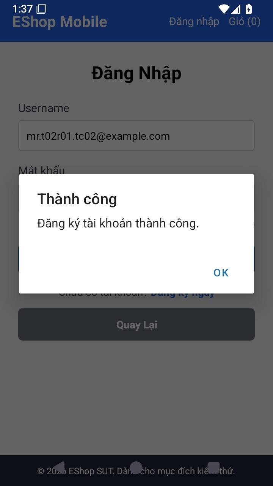
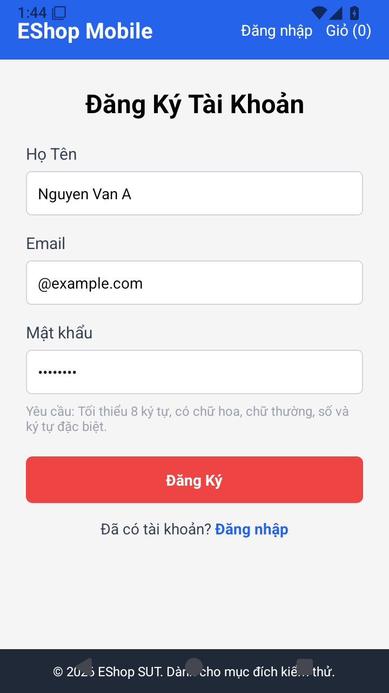
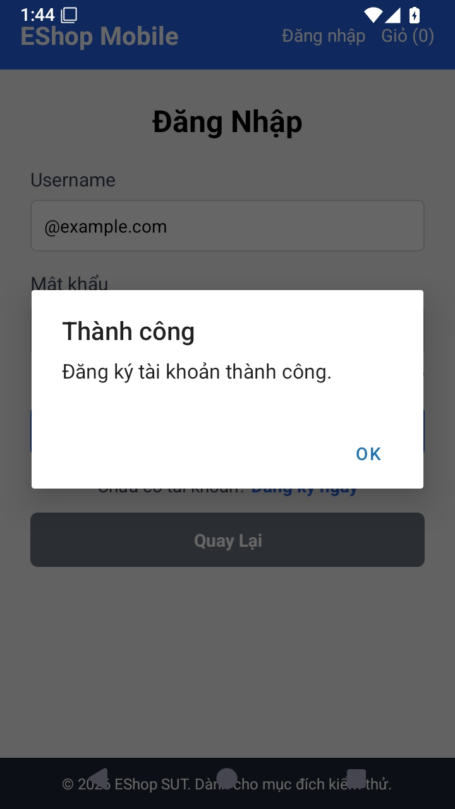
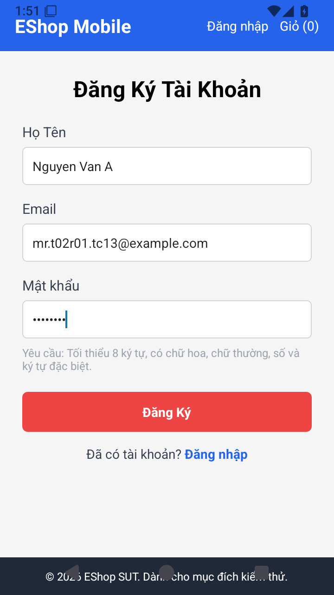
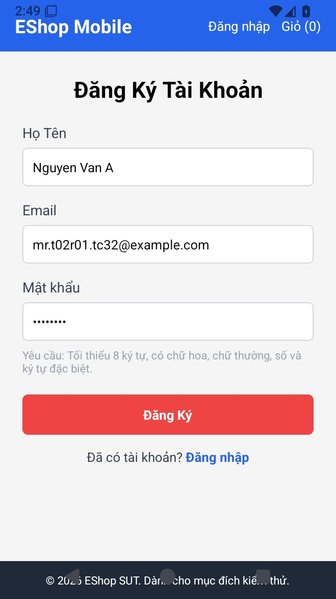
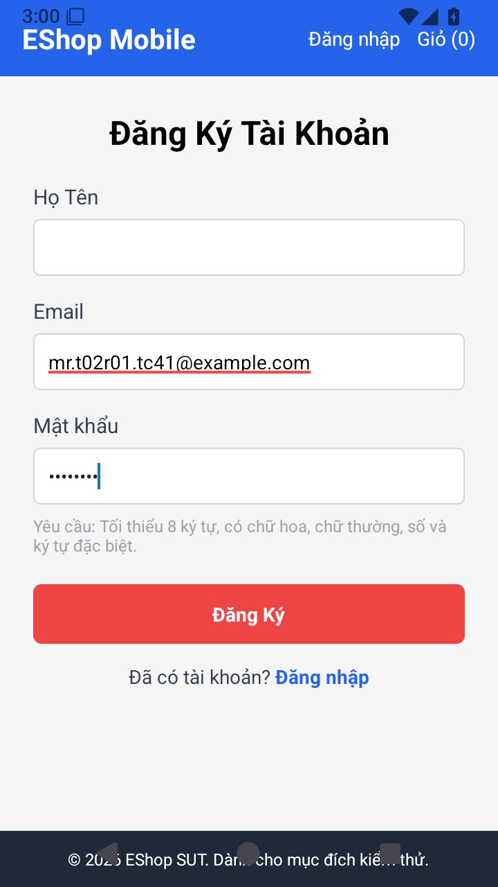
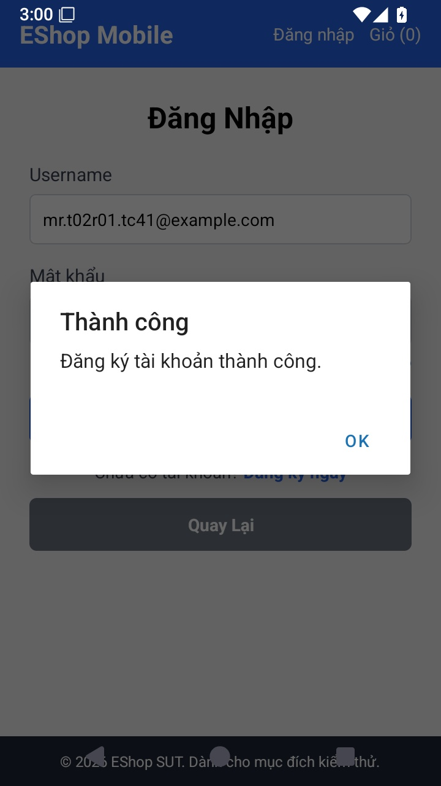
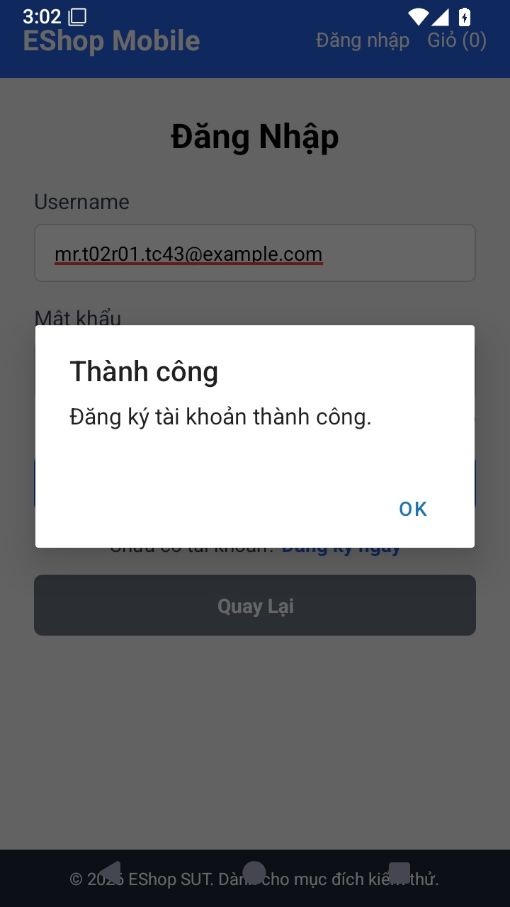
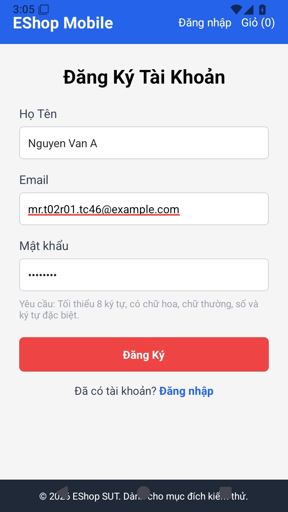

# Báo cáo kết quả — Mobile Account Registration

**HW02 / Pool D — Trần Quốc Vỹ — 23120410.** Tổng hợp các run thực tế; execution do Codex thực hiện, chưa ghi nhận sinh viên review kết quả.

## 1. Phạm vi và môi trường

Nguồn: [design.md](design.md) và [test-cases.md](test-cases.md) v0.3, đã duyệt tại commit `5ca63e1`. Bộ 54 TC giữ nguyên input/expected. Domain dùng nguồn tham khảo Kaner (reference-provisional); BVA theo tài liệu tự học môn trang 44 như thiết kế. Không sinh lại mô hình trong báo cáo execution.

Run chính `MR-RUN-01`: 01:35:19 20/10/2026 (UTC+07:00) đến khi dừng 02:08:49 20/10/2026 (UTC+07:00). Base SUT/test `b8b1d2b`; source nghiệp vụ giữ nguyên. Android 15/API 35, emulator-5554, 720×1280, Expo Go 54.0.8/SDK 54, React Native 0.81.5; Windows 11, Node 24.14.0.

Backend chạy từ bản sao isolated cổng 3001; Mobile chỉ đổi API URL sang 192.168.101.4:3001, Metro 8083. Database T01 và database gốc không bị reset. Seed có admin@eshop.com/test@eshop.com; probe dùng namespace riêng, run chính dùng t02r01. Mọi submit qua native UI; DB chỉ đọc để kiểm tra persistence.

**Lịch sử execution:**

- `MR-RUN-01`: 01:35:19 20/10/2026 (UTC+07:00) → 02:08:49 20/10/2026 (UTC+07:00); interrupted.
- `MR-RUN-02`: 02:44:50 20/10/2026 (UTC+07:00) → 02:45:35 20/10/2026 (UTC+07:00); finished.
- `MR-RUN-03`: 02:45:48 20/10/2026 (UTC+07:00) → 02:49:26 20/10/2026 (UTC+07:00); stopped.
- `MR-RUN-04`: 02:50:21 20/10/2026 (UTC+07:00) → 02:52:00 20/10/2026 (UTC+07:00); stopped.
- `MR-RUN-05`: 02:52:40 20/10/2026 (UTC+07:00) → 02:56:16 20/10/2026 (UTC+07:00); interrupted.
- `MR-RUN-06`: 02:56:16 20/10/2026 (UTC+07:00) → 02:58:35 20/10/2026 (UTC+07:00); finished.
- `MR-RUN-07`: 02:58:53 20/10/2026 (UTC+07:00) → 03:13:02 20/10/2026 (UTC+07:00); finished.

Từ MR-RUN-02, giữ phiên app đang mở, không restart Expo cho từng TC. MR-RUN-02/03 rút gọn bước setup khi đã ở Login/Register bằng cách quay lại form hoặc thay input; đây là điều chỉnh setup, vẫn kiểm tra P0 và dữ liệu riêng. Từ MR-RUN-04 điều hướng Home → Login → Register theo S bằng cùng phiên app. Layout dùng `--no-idle` cùng kiểm tra màn hình/feedback rõ ràng. Backend/DB được tái sử dụng, không reset; input, expected, các bước submit/quan sát và sequence giữ theo TC. Hash code dùng cho mỗi run nằm trong nguồn kết quả.

[results.json](results.json) là nguồn chung: metadata run một lần, mỗi TC một entry, sequence nằm trong entry; observation UI, count/dữ liệu account trước–sau và history probe đủ đối chiếu. Không giữ bộ ảnh/layout riêng cho từng TC trong bản bàn giao.

## 2. Kết quả hiện hành

**54 TC thiết kế: 35 Đạt, 15 Không đạt, 4 Bị chặn, 0 Chưa chạy.** Executed = 50/54; not_executed = 4; pass rate trên executed = 70.00%. Mỗi TC lấy kết quả main/resume mới nhất theo `selected_results`; probe và lượt rerun không cộng thành TC mới. Lịch sử blocked của TC26 và lần dở dang TC29 vẫn được giữ.

**8 nhóm phát hiện:** 4 vi phạm requirement và 4 sai khác so với quy ước S7 đã duyệt; chưa đăng GitHub Issues. Một nhóm có thể ảnh hưởng nhiều TC, không đếm mỗi TC fail thành một bug.

**Coverage đã exercise:** 33/37 mục tiêu miền (89.19%); 18/18 boundary items (100.00%). Đây là số item đã đi tới điều kiện/quan sát, không phải tỷ lệ pass. Confirmation schema D23 được quan sát; equality D24–27 chưa exercise khi C-guard chặn. BVA đủ item không có nghĩa mọi rule hoặc mọi dữ liệu Unicode đều đúng.

### Cách đọc và kiểm chứng

Mỗi hàng cho biết **kiểm tra gì → mong đợi gì → quan sát được gì → kết luận**. Bấm mã TC để mở bộ thiết kế, rồi tìm đúng ID (Ctrl+F); bấm mã bug để xem bước tái hiện và JPG bên dưới. `results.json` dành cho đối chiếu assertion, dữ liệu trước–sau hoặc lịch sử khi cần; không cần đọc JSON để hiểu bảng.

**Dữ liệu mặc định:** N = Họ Tên `Nguyen Van A`; E = Email riêng của TC, dạng `mr.t02r01.tcNN@example.com`; P = Password `Abcde1!x`; C = Confirmation (Xác nhận mật khẩu), nhập bằng P nếu UI có field. Bảng chỉ ghi phần thay đổi so với mặc định; “nominal” cũng nghĩa là dùng giá trị mặc định. U/L/D/S lần lượt là số chữ hoa/chữ thường/chữ số/dấu hoặc ký hiệu: U1 nghĩa là có 1 chữ hoa. Input ở ca chưa chạy là dữ liệu **dự kiến theo thiết kế**, chưa xác nhận đã nhập.

**Expected:** “Chấp nhận” nghĩa là tạo đúng 1 tài khoản với name/email đúng theo thiết kế và chuyển tới Đăng nhập; “Từ chối” nghĩa là có phản hồi thất bại, không tạo tài khoản mới và không xử lý như đăng ký thành công. Các yêu cầu sequence/trim/giữ dữ liệu cũ được ghi riêng. Special = dấu/ký hiệu; code point = đơn vị đếm Unicode đã chốt. S7 là quy ước bổ sung đã duyệt, khác với requirement được viết rõ; nguồn chi tiết ở bộ TC.

**Kết luận:** Đạt = actual đáp ứng expected; Không đạt = có khác biệt; Bị chặn = thiếu điều kiện/trường UI hoặc lỗi công cụ/môi trường ngăn đánh giá; Chưa chạy = chưa bắt đầu hoặc chưa có kết quả hoàn tất. Actual dùng số tài khoản **theo email đang kiểm tra**, không phải tổng số tài khoản của hệ thống. Các ca N/E/P chưa chứng minh rule Confirmation nếu form thiếu field.

### A. Tên và email

| TC | Nội dung kiểm tra / input chính | Expected — mong đợi | Actual — đã quan sát | Kết luận / bug |
| --- | --- | --- | --- | --- |
| [MR-TC01](test-cases.md) | Dữ liệu hợp lệ (control): Bộ mặc định của TC01 | Chấp nhận bộ dữ liệu hợp lệ; chưa đánh giá rule Confirmation | bước 1: tài khoản 0→1; báo thành công; Đăng nhập; name/email lưu đúng | **Đạt** (passed) |
| [MR-TC02](test-cases.md) | Tên để trống: N=`""` (0 ký tự) | Từ chối vì thiếu Họ Tên | bước 1: tài khoản 0→1; báo thành công; Đăng nhập | **Không đạt** (failed); [MR-BUG01](#mr-bug01) |
| [MR-TC03](test-cases.md) | Tên dài 1 ký tự: N=`V` (1 ký tự) | Chấp nhận với tên nonempty | bước 1: tài khoản 0→1; báo thành công; Đăng nhập; name/email lưu đúng | **Đạt** (passed) |
| [MR-TC04](test-cases.md) | Tên dài 2 ký tự: N=`Vy` (2 ký tự) | Chấp nhận | bước 1: tài khoản 0→1; báo thành công; Đăng nhập; name/email lưu đúng | **Đạt** (passed) |
| [MR-TC05](test-cases.md) | Tên tiếng Việt có dấu: N=`Trần Quốc Vỹ` | Chấp nhận | bước 1: tài khoản 0→1; báo thành công; Đăng nhập; name/email lưu đúng | **Đạt** (passed) |
| [MR-TC06](test-cases.md) | Email để trống: E=`""` | Từ chối vì thiếu Email | bước 1: tài khoản 0→1; báo thành công; Đăng nhập | **Không đạt** (failed); [MR-BUG02](#mr-bug02) |
| [MR-TC07](test-cases.md) | Email thiếu @: E=`mr.t02r01.tc07.example.com` | Từ chối vì thiếu `@` | bước 1: tài khoản 0→1; báo thành công; Đăng nhập | **Không đạt** (failed); [MR-BUG02](#mr-bug02) |
| [MR-TC08](test-cases.md) | Email thiếu local-part: E=`@example.com` | Từ chối vì thiếu local-part | bước 1: tài khoản 0→1; báo thành công; Đăng nhập | **Không đạt** (failed); [MR-BUG02](#mr-bug02) |
| [MR-TC09](test-cases.md) | Email thiếu domain: E=`mr.t02r01.tc09@` | Từ chối vì thiếu domain | bước 1: tài khoản 0→1; báo thành công; Đăng nhập | **Không đạt** (failed); [MR-BUG02](#mr-bug02) |
| [MR-TC10](test-cases.md) | Email có space trong local-part: E=`mr t02r01.tc10@example.com` (space sau `mr`) | Từ chối vì space trong local-part không quote của địa chỉ đơn giản | bước 1: tài khoản 0→1; báo thành công; Đăng nhập | **Không đạt** (failed); [MR-BUG02](#mr-bug02) |
| [MR-TC11](test-cases.md) | Email có hai @: E=`mr.t02r01.tc11@@example.com` | Từ chối vì hai `@` liên tiếp, không quote | bước 1: tài khoản 0→1; báo thành công; Đăng nhập | **Không đạt** (failed); [MR-BUG02](#mr-bug02) |
| [MR-TC12](test-cases.md) | Email trùng dữ liệu có sẵn: E=`test@eshop.com`; N/P nominal | Từ chối email trùng; số tài khoản không tăng, dữ liệu cũ không đổi | bước 1: tài khoản 1→2; báo thành công; Đăng nhập | **Không đạt** (failed); [MR-BUG03](#mr-bug03) |
| [MR-TC13](test-cases.md) | Đăng ký hai lần cùng email: Cả hai submit dùng E13, N/P nominal | Lần 1 chấp nhận, lần 2 từ chối email trùng; cuối cùng chỉ có 1 tài khoản E13 | bước 1: tài khoản 0→1; báo thành công; Đăng nhập; bước 2: tài khoản 1→2; báo thành công; Đăng nhập | **Không đạt** (failed); [MR-BUG03](#mr-bug03) |

### B. Password: miền và biên

| TC | Nội dung kiểm tra / input chính | Expected — mong đợi | Actual — đã quan sát | Kết luận / bug |
| --- | --- | --- | --- | --- |
| [MR-TC14](test-cases.md) | Password để trống: P=`""` | Từ chối thiếu password | bước 1: tài khoản không đổi; có phản hồi từ chối; form Đăng ký | **Đạt** (passed) |
| [MR-TC15](test-cases.md) | Password dài 7 ký tự: P=`Abcde1!` (7) | Từ chối vì 7<8, các nhóm ký tự khác đủ | bước 1: tài khoản không đổi; có phản hồi từ chối; form Đăng ký | **Đạt** (passed) |
| [MR-TC16](test-cases.md) | Password dài 8 ký tự: P=`Abcde1!x` (8; U1,L5,D1,S1) | Chấp nhận tại ngưỡng 8, đúng một hoa/số/S | bước 1: tài khoản 0→1; báo thành công; Đăng nhập; name/email lưu đúng | **Đạt** (passed) |
| [MR-TC17](test-cases.md) | Password dài 9 ký tự: P=`Abcde1!xy` (9) | Chấp nhận phía trên ngưỡng, không chỉ đúng 8 mới được chấp nhận | bước 1: tài khoản 0→1; báo thành công; Đăng nhập; name/email lưu đúng | **Đạt** (passed) |
| [MR-TC18](test-cases.md) | Password không có chữ hoa: P=`abcde1!x` (8; U0,L6,D1,S1) | Từ chối chỉ vì thiếu chữ hoa | bước 1: tài khoản không đổi; có phản hồi từ chối; form Đăng ký | **Đạt** (passed) |
| [MR-TC19](test-cases.md) | Password có 2 chữ hoa: P=`ABcde1!x` (8; U2,L4,D1,S1) | Chấp nhận với 2 chữ hoa | bước 1: tài khoản 0→1; báo thành công; Đăng nhập; name/email lưu đúng | **Đạt** (passed) |
| [MR-TC20](test-cases.md) | Password không có chữ thường: P=`ABCDE1!X` (8; U6,L0,D1,S1) | Từ chối chỉ vì thiếu chữ thường | bước 1: tài khoản không đổi; có phản hồi từ chối; form Đăng ký | **Đạt** (passed) |
| [MR-TC21](test-cases.md) | Password có 1 chữ thường: P=`ABCDa1!X` (8; U5,L1,D1,S1) | Chấp nhận đúng 1 chữ thường | bước 1: tài khoản 0→1; báo thành công; Đăng nhập; name/email lưu đúng | **Đạt** (passed) |
| [MR-TC22](test-cases.md) | Password có 2 chữ thường: P=`ABCDab1!` (8; U4,L2,D1,S1) | Chấp nhận với 2 chữ thường | bước 1: tài khoản 0→1; báo thành công; Đăng nhập; name/email lưu đúng | **Đạt** (passed) |
| [MR-TC23](test-cases.md) | Password không có chữ số: P=`Abcdef!x` (8; U1,L6,D0,S1) | Từ chối chỉ vì thiếu chữ số | bước 1: tài khoản không đổi; có phản hồi từ chối; form Đăng ký | **Đạt** (passed) |
| [MR-TC24](test-cases.md) | Password có 2 chữ số: P=`Abcde12!` (8; U1,L4,D2,S1) | Chấp nhận với 2 chữ số | bước 1: tài khoản 0→1; báo thành công; Đăng nhập; name/email lưu đúng | **Đạt** (passed) |
| [MR-TC25](test-cases.md) | Password không có special: P=`Abcde12x` (8; U1,L5,D2,S0; chỉ alphanumeric) | Từ chối vì hoàn toàn thiếu dấu/ký hiệu | bước 1: tài khoản không đổi; có phản hồi từ chối; form Đăng ký | **Đạt** (passed) |
| [MR-TC26](test-cases.md) | Password có 2 special: P=`Abcde1!!` (8; U1,L4,D1,S2) | Chấp nhận với 2 dấu/ký hiệu `!` | bước 1: tài khoản 0→1; báo thành công; Đăng nhập; name/email lưu đúng | **Đạt** (passed) |
| [MR-TC27](test-cases.md) | Special là @: P=`Abcde1@x` | Chấp nhận với `@` là dấu/ký hiệu duy nhất | bước 1: tài khoản 0→1; báo thành công; Đăng nhập; name/email lưu đúng | **Đạt** (passed) |
| [MR-TC28](test-cases.md) | Special là $: P=`Abcde1$x` | Chấp nhận với `$` là dấu/ký hiệu duy nhất | bước 1: tài khoản 0→1; báo thành công; Đăng nhập; name/email lưu đúng | **Đạt** (passed) |
| [MR-TC29](test-cases.md) | Special là %: P=`Abcde1%x` | Chấp nhận với `%` là dấu/ký hiệu duy nhất | bước 1: tài khoản 0→1; báo thành công; Đăng nhập; name/email lưu đúng | **Đạt** (passed) |
| [MR-TC30](test-cases.md) | Special là *: P=`Abcde1*x` | Chấp nhận với `*` là dấu/ký hiệu duy nhất | bước 1: tài khoản 0→1; báo thành công; Đăng nhập; name/email lưu đúng | **Đạt** (passed) |
| [MR-TC31](test-cases.md) | Special là ?: P=`Abcde1?x` | Chấp nhận với `?` là dấu/ký hiệu duy nhất | bước 1: tài khoản 0→1; báo thành công; Đăng nhập; name/email lưu đúng | **Đạt** (passed) |
| [MR-TC32](test-cases.md) | Special là &: P=`Abcde1&x` | Chấp nhận với `&` là dấu/ký hiệu duy nhất | bước 1: tài khoản 0→1; báo thành công; Đăng nhập; name/email lưu đúng | **Đạt** (passed) |

### C. Confirmation và trạng thái

| TC | Nội dung kiểm tra / input chính | Expected — mong đợi | Actual — đã quan sát | Kết luận / bug |
| --- | --- | --- | --- | --- |
| [MR-TC33](test-cases.md) | Form có Confirmation: Không submit; form ban đầu | Có trường Xác nhận mật khẩu, nhập được độc lập với P. Không suy chỉ từ một viewport | Đã kiểm tra toàn form: chỉ có Họ Tên, Email, Password; không có Confirmation; 0 submit. | **Không đạt** (failed); [MR-BUG04](#mr-bug04) |
| [MR-TC34](test-cases.md) | Confirmation để trống: N/E34/P nominal; C=`""` | Từ chối vì không khớp với P nonempty | Thiếu Confirmation; không thể nhập/so sánh C trên native; 0 submit. | **Bị chặn** (blocked); phụ thuộc [MR-BUG04](#mr-bug04) |
| [MR-TC35](test-cases.md) | Confirmation cùng độ dài nhưng khác nội dung: P=`Abcde1!x`, C=`Abcde1!y` (đều 8, khác ký tự cuối) | Từ chối dù hai chuỗi cùng độ dài | Thiếu Confirmation; không thể nhập/so sánh C trên native; 0 submit. | **Bị chặn** (blocked); phụ thuộc [MR-BUG04](#mr-bug04) |
| [MR-TC36](test-cases.md) | Confirmation là prefix ngắn hơn password: P=`Abcde1!x`, C=`Abcde1!` (7, là prefix của P) | Từ chối vì không bằng nhau | Thiếu Confirmation; không thể nhập/so sánh C trên native; 0 submit. | **Bị chặn** (blocked); phụ thuộc [MR-BUG04](#mr-bug04) |
| [MR-TC37](test-cases.md) | Confirmation bằng password: P=C=`Abcde1!x`, N/E37 nominal | Chấp nhận và chuyển sang Đăng nhập | Thiếu Confirmation; không thể nhập/so sánh C trên native; 0 submit. | **Bị chặn** (blocked); phụ thuộc [MR-BUG04](#mr-bug04) |
| [MR-TC38](test-cases.md) | Sửa password từ 7 thành 8 ký tự: Lần 1 P=`Abcde1!` (7); lần 2 sửa P=`Abcde1!x` (8); cùng N/E38; sửa C theo P nếu có | Lần 1 từ chối, chưa tạo E38; lần 2 chấp nhận; cuối sequence có đúng 1 tài khoản E38 | bước 1: tài khoản không đổi; có phản hồi từ chối; form Đăng ký; bước 2: tài khoản 0→1; báo thành công; Đăng nhập; name/email lưu đúng | **Đạt** (passed) |
| [MR-TC39](test-cases.md) | Email trùng và password thiếu chữ hoa: E=`test@eshop.com`, P=`abcde1!x` (thiếu hoa), N nominal | Từ chối, không thêm/sửa tài khoản đã tồn tại. Bất kỳ rule invalid nào được thông báo trước đều được | bước 1: tài khoản không đổi; có phản hồi từ chối; form Đăng ký | **Đạt** (passed) |
| [MR-TC40](test-cases.md) | Password dài 64 ký tự: P = `Ab1!` lặp 16 lần (64 ký tự); C=P nếu có | Chấp nhận | bước 1: tài khoản 0→1; báo thành công; Đăng nhập; name/email lưu đúng | **Đạt** (passed) |

### D. Quy ước đã duyệt (S7)

| TC | Nội dung kiểm tra / input chính | Expected — mong đợi | Actual — đã quan sát | Kết luận / bug |
| --- | --- | --- | --- | --- |
| [MR-TC41](test-cases.md) | Tên chỉ có space: N=` ` (1 space), E41/P nominal | Từ chối vì tên sau trim rỗng | bước 1: tài khoản 0→1; báo thành công; Đăng nhập | **Không đạt** (failed); [MR-BUG05](#mr-bug05) |
| [MR-TC42](test-cases.md) | Email khác chữ hoa/thường: E=`TEST@eshop.com`, N/P nominal | Chấp nhận tạo đúng 1 tài khoản `TEST@eshop.com`, tài khoản `test@eshop.com` cũ giữ nguyên. Email khác case là hai chuỗi khác theo review S7/Q02 | bước 1: tài khoản 0→1; báo thành công; Đăng nhập; name/email lưu đúng | **Đạt** (passed) |
| [MR-TC43](test-cases.md) | Email có space đầu/cuối: E=` mr.t02r01.tc43@example.com ` (1 space đầu/cuối), N/P nominal | Chấp nhận, chỉ tạo tài khoản với email `mr.t02r01.tc43@example.com` đã bỏ space đầu/cuối; không lưu dạng có space | Báo thành công/Đăng nhập; email có space 0→1, email đã trim 0→0; lưu sai dạng email. | **Không đạt** (failed); [MR-BUG06](#mr-bug06) |
| [MR-TC44](test-cases.md) | Special mở rộng là #: P=`Abcde1#x` (8 code point, special duy nhất `#`) | Chấp nhận vì `#` là dấu Unicode thuộc Punctuation | bước 1: tài khoản 0→1; báo thành công; Đăng nhập; name/email lưu đúng | **Đạt** (passed) |
| [MR-TC45](test-cases.md) | Space không thay thế special: P=`Abcde1 x` (8 code point, 1 space giữa `1` và `x`, không có dấu/ký hiệu) | Từ chối vì space không đáp ứng yêu cầu dấu/ký hiệu | bước 1: tài khoản 0→1; báo thành công; Đăng nhập | **Không đạt** (failed); [MR-BUG07](#mr-bug07) |
| [MR-TC46](test-cases.md) | Độ dài Unicode: 7 code point: P=`Abc1!😀d` (7 code point, 8 UTF-16 unit), C=P nếu có | Từ chối vì 7<8 code point, dù đủ 8 UTF-16 unit. Có đủ hoa/thường/số/dấu/ký hiệu | bước 1: tài khoản 0→1; báo thành công; Đăng nhập | **Không đạt** (failed); [MR-BUG08](#mr-bug08) |

### E. Unicode và tương tác dữ liệu (S7)

| TC | Nội dung kiểm tra / input chính | Expected — mong đợi | Actual — đã quan sát | Kết luận / bug |
| --- | --- | --- | --- | --- |
| [MR-TC47](test-cases.md) | Độ dài Unicode: 8 code point: P=`Abc1!😀de` (8 code point, 9 UTF-16 unit), C=P nếu có | Chấp nhận tại ngưỡng 8 code point, đủ các nhóm ký tự | bước 1: tài khoản 0→1; báo thành công; Đăng nhập; name/email lưu đúng | **Đạt** (passed) |
| [MR-TC48](test-cases.md) | Độ dài Unicode: 9 code point: P=`Abc1!😀def` (9 code point, 10 UTF-16 unit), C=P nếu có | Chấp nhận phía trên ngưỡng | bước 1: tài khoản 0→1; báo thành công; Đăng nhập; name/email lưu đúng | **Đạt** (passed) |
| [MR-TC49](test-cases.md) | Special mở rộng là _: P=`Abcde1_x` (8 code point, special duy nhất `_`) | Chấp nhận vì `_` thuộc Punctuation | bước 1: tài khoản 0→1; báo thành công; Đăng nhập; name/email lưu đúng | **Đạt** (passed) |
| [MR-TC50](test-cases.md) | Emoji là special duy nhất: P=`Abcdef1😀` (8 code point, special duy nhất `😀`) | Chấp nhận vì emoji này thuộc Symbol | bước 1: tài khoản 0→1; báo thành công; Đăng nhập; name/email lưu đúng | **Đạt** (passed) |
| [MR-TC51](test-cases.md) | Special là em dash: P=`Abcde1—x` (8 code point, special duy nhất là em dash `—`, không phải dấu trừ) | Chấp nhận vì `—` thuộc Punctuation | bước 1: tài khoản 0→1; báo thành công; Đăng nhập; name/email lưu đúng | **Đạt** (passed) |
| [MR-TC52](test-cases.md) | Special là ký hiệu euro: P=`Abcde1€x` (8 code point, special duy nhất `€`) | Chấp nhận vì `€` thuộc Symbol | bước 1: tài khoản 0→1; báo thành công; Đăng nhập; name/email lưu đúng | **Đạt** (passed) |
| [MR-TC53](test-cases.md) | Email sau trim bị trùng: E=` test@eshop.com ` (1 space đầu/cuối), N/P nominal | Từ chối vì sau bỏ space đầu/cuối email trùng `test@eshop.com`; không tạo tài khoản ở cả hai dạng và không sửa dữ liệu cũ | bước 1: tài khoản 0→1; báo thành công; Đăng nhập | **Không đạt** (failed); [MR-BUG06](#mr-bug06) |
| [MR-TC54](test-cases.md) | Password có cả special và space: P=`Abc1! xy` (8 code point, có `!` và 1 space sau `!`), C=P nếu có | Chấp nhận vì `!` thỏa dấu/ký hiệu, space không bị dùng để thay dấu/ký hiệu và chưa có rule cấm mọi space | bước 1: tài khoản 0→1; báo thành công; Đăng nhập; name/email lưu đúng | **Đạt** (passed) |

## 3. Phát hiện và evidence

MR-BUG01–04 đối chiếu requirement FR-01 áp dụng cho Mobile qua FR-20. MR-BUG05–08 là sai khác so với quy ước S7 đã duyệt, không gán thành yêu cầu README viết rõ. Severity là đề xuất theo tác động. Detail và ảnh nằm ngay trong report; chưa đăng GitHub Issues, chưa có ảnh trang issue.

**Đọc evidence:** JPG chứng minh phần UI hiển thị; persistence được đối chiếu bằng observations/DB chỉ đọc. Password bị che: native command đã nhận input, chưa đọc lại plaintext. Các caption ghi TC/run, trạng thái và thời gian chụp.

### MR-BUG01 — Họ Tên rỗng vẫn đăng ký thành công

**Oracle:** FR-01 / MR-R01. **TC:** MR-TC02. **Severity đề xuất:** Medium.

**Precondition/steps:** Mở Home → Đăng nhập → Đăng ký ngay. Để Họ Tên rỗng; Email=mr.t02r01.tc02@example.com; Password=Abcde1!x. Bấm Đăng ký một lần.

**Expected:** REJECT, có feedback và không tạo account khi thiếu Họ Tên.

**Actual:** bước 1: account 0→1; báo thành công; Login

DB lưu một account mới với `name=""`; ảnh chỉ cho thấy báo thành công/Login. Input rỗng và dữ liệu lưu phải đọc cùng observation TC02 trong results.json.

*MR-TC02/MR-RUN-01 — Actual: 01:37:36 20/10/2026 (UTC+07:00). JPG từ capture thật; không chụp mới khi tổng hợp.*

**Tần suất quan sát:** 1 TC liên quan, mỗi TC chạy một lần trong run chính; không coi đó là nhiều lần lặp độc lập của cùng một input.

### MR-BUG02 — Email rỗng hoặc sai định dạng vẫn được chấp nhận

**Oracle:** FR-01 / MR-R02. **TC:** MR-TC06, MR-TC07, MR-TC08, MR-TC09, MR-TC10, MR-TC11. **Severity đề xuất:** High.

**Precondition/steps:** Mở form Đăng ký. Nhập Họ Tên=Nguyen Van A; Email=@example.com; Password=Abcde1!x. Bấm Đăng ký một lần. Các TC cùng nhóm kiểm tra email rỗng, thiếu @, thiếu domain, space trong local-part và hai @.

**Expected:** REJECT email rỗng/sai định dạng, không tạo account.

**Actual:** bước 1: account 0→1; báo thành công; Login

TC08 lưu account email `@example.com`; các TC06–11 đều có count 0→1 và báo thành công.

 

*MR-TC08/MR-RUN-01 — Input: 01:44:33 20/10/2026 (UTC+07:00); Actual: 01:44:39 20/10/2026 (UTC+07:00). JPG từ capture thật; không chụp mới khi tổng hợp.*

**Tần suất quan sát:** 6 TC liên quan, mỗi TC chạy một lần trong run chính; không coi đó là nhiều lần lặp độc lập của cùng một input.

### MR-BUG03 — Đăng ký trùng email tạo thêm account

**Oracle:** FR-01 / MR-R03. **TC:** MR-TC12, MR-TC13. **Severity đề xuất:** High.

**Precondition/steps:** TC12 dùng test@eshop.com đã có trong seed. TC13: nhập Nguyen Van A / mr.t02r01.tc13@example.com / Abcde1!x; đăng ký lần đầu, đóng alert, navigate về Đăng ký và submit lại cùng dữ liệu. Không reset backend giữa hai lần.

**Expected:** Lần đăng ký trùng phải REJECT; số account theo email không tăng và các account cũ giữ nguyên.

**Actual:** bước 1: account 0→1; báo thành công; Login; bước 2: account 1→2; báo thành công; Login

TC12 tăng account `test@eshop.com` từ 1→2; TC13 tăng 0→1 ở bước đầu rồi 1→2 ở bước đăng ký trùng. Các account cũ được quan sát giữ nguyên.

 

*MR-TC13/MR-RUN-01 — Input: 01:51:31 20/10/2026 (UTC+07:00); Actual: 01:51:37 20/10/2026 (UTC+07:00). JPG từ capture thật; không chụp mới khi tổng hợp.*

**Tần suất quan sát:** 2 TC liên quan, mỗi TC chạy một lần trong run chính; không coi đó là nhiều lần lặp độc lập của cùng một input.

### MR-BUG04 — Form Đăng ký thiếu trường Xác nhận mật khẩu

**Phân loại:** Vi phạm requirement. **Oracle:** FR-01 / MR-R10, áp dụng cho Mobile qua FR-20. **TC:** MR-TC33. **Severity đề xuất:** High.

**Precondition/steps:** Backend/fixture theo môi trường ở §1; người dùng chưa đăng nhập. Mở Home → Đăng nhập → Đăng ký ngay; quan sát toàn form và scroll đến cuối. Không submit.

**Expected:** Có field Confirmation riêng, nhập được độc lập với Password.

**Actual MR-TC33 / MR-RUN-03:** Full-form inspection: Required native Confirmation field is absent after full-form inspection

**Tác động:** Không thực hiện được bước xác nhận mật khẩu và các ca equality phụ thuộc field này.

*MR-TC33 / MR-RUN-03; actual; chụp 02:49:09 20/10/2026 (UTC+07:00).*

**Tần suất:** 1 TC liên quan, mỗi TC chạy một lần; chưa đo lặp độc lập cùng một input. **GitHub:** chưa đăng.

### MR-BUG05 — Tên chỉ có khoảng trắng vẫn tạo tài khoản

**Phân loại:** Sai khác quy ước S7. **Oracle:** Review S7/Q01; MR-R01 / MR-D30. **TC:** MR-TC41. **Severity đề xuất:** Medium.

**Precondition/steps:** Backend/fixture theo môi trường ở §1; người dùng chưa đăng nhập. Trên form Đăng ký, nhập N là đúng 1 space; E=mr.t02r01.tc41@example.com; P=Abcde1!x. Submit một lần.

**Expected:** Theo S7, từ chối tên sau trim rỗng; không tạo account.

**Actual MR-TC41 / MR-RUN-07:** bước 1: tài khoản 0→1; báo thành công; Đăng nhập

Quan sát DB chỉ đọc, bước 1: email='mr.t02r01.tc41@example.com': 0→1, dữ liệu cũ giữ nguyên.

Dữ liệu account mới: name=' ', email='mr.t02r01.tc41@example.com'.

**Tác động:** Dữ liệu tên không có nội dung vẫn được lưu; đây là sai khác với quy ước S7 đã duyệt.

*MR-TC41 / MR-RUN-07; input; chụp 03:00:43 20/10/2026 (UTC+07:00).*

*MR-TC41 / MR-RUN-07; actual; chụp 03:00:45 20/10/2026 (UTC+07:00).*

**Tần suất:** 1 TC liên quan, mỗi TC chạy một lần; chưa đo lặp độc lập cùng một input. **GitHub:** chưa đăng.

### MR-BUG06 — Email có khoảng trắng đầu/cuối không được chuẩn hóa theo S7

**Phân loại:** Sai khác quy ước S7. **Oracle:** Review S7/Q03; MR-R02–03 / MR-D32, MR-D36. **TC:** MR-TC43, MR-TC53. **Severity đề xuất:** Medium.

**Precondition/steps:** Backend/fixture theo môi trường ở §1; người dùng chưa đăng nhập. TC43: nhập E=" mr.t02r01.tc43@example.com ", N/P mặc định, submit. TC53: nhập E=" test@eshop.com " khi dạng không space đã tồn tại; submit một lần. Không trim trước bằng tool.

**Expected:** TC43 chỉ lưu email đã trim; TC53 từ chối email trùng sau trim, không thêm/sửa account ở cả hai dạng.

**Actual MR-TC43 / MR-RUN-07:** bước 1: tài khoản 0→1; báo thành công; Đăng nhập

Quan sát DB chỉ đọc, bước 1: email=' mr.t02r01.tc43@example.com ': 0→1, dữ liệu cũ giữ nguyên; email='mr.t02r01.tc43@example.com': 0→0, dữ liệu cũ giữ nguyên.

Dữ liệu account mới: name='Nguyen Van A', email=' mr.t02r01.tc43@example.com '.

**Actual MR-TC53 / MR-RUN-07:** bước 1: tài khoản 0→1; báo thành công; Đăng nhập

Quan sát DB chỉ đọc, bước 1: email=' test@eshop.com ': 0→1, dữ liệu cũ giữ nguyên; email='test@eshop.com': 2→2, dữ liệu cũ giữ nguyên.

Dữ liệu account mới: name='Nguyen Van A', email=' test@eshop.com '.

**Tác động:** Việc lưu/so khớp email có padding khác chính sách chuẩn hóa đã duyệt; tách khỏi lỗi uniqueness requirement MR-BUG03.

Ảnh đại diện chụp TC43; kết quả TC53 được đối chiếu bằng observations/DB riêng ở trên.

*MR-TC43 / MR-RUN-07; input; chụp 03:02:37 20/10/2026 (UTC+07:00).*

*MR-TC43 / MR-RUN-07; actual; chụp 03:02:38 20/10/2026 (UTC+07:00).*

**Tần suất:** 2 TC liên quan, mỗi TC chạy một lần; chưa đo lặp độc lập cùng một input. **GitHub:** chưa đăng.

### MR-BUG07 — Khoảng trắng được chấp nhận thay cho special trong password

**Phân loại:** Sai khác quy ước S7. **Oracle:** Review S7/Q04; MR-R09 / MR-D34. **TC:** MR-TC45. **Severity đề xuất:** Medium.

**Precondition/steps:** Backend/fixture theo môi trường ở §1; người dùng chưa đăng nhập. Nhập N/E45 mặc định và P="Abcde1 x" (8 code point, có space nhưng không có dấu/ký hiệu). Submit một lần.

**Expected:** Theo S7, từ chối vì space không được tính là special; không tạo account.

**Actual MR-TC45 / MR-RUN-07:** bước 1: tài khoản 0→1; báo thành công; Đăng nhập

Quan sát DB chỉ đọc, bước 1: email='mr.t02r01.tc45@example.com': 0→1, dữ liệu cũ giữ nguyên.

Dữ liệu account mới: name='Nguyen Van A', email='mr.t02r01.tc45@example.com'.

**Tác động:** Password không có dấu/ký hiệu vẫn được chấp nhận theo runtime, khác quy ước special đã duyệt.

*MR-TC45 / MR-RUN-07; input; chụp 03:04:30 20/10/2026 (UTC+07:00).*

*MR-TC45 / MR-RUN-07; actual; chụp 03:04:31 20/10/2026 (UTC+07:00).*

**Tần suất:** 1 TC liên quan, mỗi TC chạy một lần; chưa đo lặp độc lập cùng một input. **GitHub:** chưa đăng.

### MR-BUG08 — Password 7 Unicode code point vẫn được chấp nhận

**Phân loại:** Sai khác quy ước S7. **Oracle:** Review S7/Q05; MR-R05 / MR-D35 / B01-7. **TC:** MR-TC46. **Severity đề xuất:** Medium.

**Precondition/steps:** Backend/fixture theo môi trường ở §1; người dùng chưa đăng nhập. Nhập N/E46 mặc định, P="Abc1!😀d" nguyên vẹn (7 code point, 8 UTF-16 unit). Submit một lần.

**Expected:** Theo S7, từ chối vì chưa đủ 8 code point; không tạo account.

**Actual MR-TC46 / MR-RUN-07:** bước 1: tài khoản 0→1; báo thành công; Đăng nhập

Quan sát DB chỉ đọc, bước 1: email='mr.t02r01.tc46@example.com': 0→1, dữ liệu cũ giữ nguyên.

Dữ liệu account mới: name='Nguyen Van A', email='mr.t02r01.tc46@example.com'.

**Tác động:** Runtime chấp nhận chuỗi dưới ngưỡng theo đơn vị đã duyệt; expected vẫn giữ Unicode code point, không đổi sang UTF-16 để làm test pass.

*MR-TC46 / MR-RUN-07; input; chụp 03:05:27 20/10/2026 (UTC+07:00).*

*MR-TC46 / MR-RUN-07; actual; chụp 03:05:28 20/10/2026 (UTC+07:00).*

**Tần suất:** 1 TC liên quan, mỗi TC chạy một lần; chưa đo lặp độc lập cùng một input. **GitHub:** chưa đăng.

## 4. Harness và AI gaps

PROBE-01–05 bị chặn trước submit do hidden node/bounds, cờ IME hoặc khởi chạy Expo/system panel; PROBE-06 pass. Đây là execution gaps có lịch sử thật, không phải bug sản phẩm. Không gọi mọi TC bổ sung sau review policy là AI bỏ sót.

TC26 ban đầu blocked vì Android CLI không lấy được idle state. MR-RUN-02 dùng `--no-idle`, kiểm tra readiness và persistence; kết quả sau được chọn theo quy ước summary, không xóa lần blocked. TC29 đã kiểm tra form/account trước khi bắt đầu lại, không tự lặp một submit có state không rõ.

MR-RUN-03 dừng sau hai C-guard liên tiếp; MR-RUN-04 phân biệt blocker schema đã biết với lỗi transport để tiếp tục phần độc lập. TC38 trong MR-RUN-04 hoàn tất lần reject đầu (account 0→0), nhưng chưa nhập được password lần hai vì bàn phím che field sau khi xuất hiện validation. Runner dừng trước submit lần hai. Sau kiểm tra UI/DB còn 0 account, xử lý field bị IME che rồi chạy lại.

MR-RUN-05 phát hiện lỗi quan sát: validation từ lần trước vẫn hiện, nhưng detector chỉ tìm text mới nên ghi nhầm TC38/39 là không feedback. Hai verdict này được giữ và đánh dấu lỗi harness, không tính thành bug sản phẩm. Đợt chạy dừng khi TC40 mới ở Login, chưa có account E40. MR-RUN-06 đọc cả validation đang hiện: TC38 hoàn tất reject→accept và TC39 reject đúng; MR-RUN-07 tiếp tục TC40–54. Đây là điều chỉnh cách quan sát, không thay expected.

Bằng chứng lỗi quan sát: [validation đang hiện trong TC38 / MR-RUN-05](images/MR-RUN-05-MR-TC38-actual.jpg). Ảnh này là chẩn đoán harness; các capture chẩn đoán trùng đã lưu ngoài repo.

Runner hiện ghi chung results, giữ app/session, không trace/layout dump hay ảnh pass; JPG chỉ lưu khi failure cần minh họa. Không thay nghiệp vụ, rule, literal input hoặc expected theo runtime. Đây là điều chỉnh harness/evidence, khác với thay thiết kế test.

## 5. Kết luận và phần còn lại

Đã có kết quả đánh giá cho 50/54 TC; 4 TC blocked (MR-TC34, MR-TC35, MR-TC36, MR-TC37); không còn TC chưa bắt đầu. Các ca Confirmation bị chặn do thiếu field thật; không gửi C bằng API hoặc tự thêm field để chạy. Một TC fail schema không thay việc thực thi các ca equality phụ thuộc.

Kết quả không đòi 100% pass để báo cáo trung thực: giữ toàn bộ fail và giới hạn. Sinh viên cần review bảng expected/actual và các ảnh/quan sát trước khi nghiệm thu. Chưa đăng GitHub Issues; chưa cập nhật AI audit, commit/push hoặc tạo video trong đợt execution này. Không xuất PDF theo lựa chọn hiện tại. Bộ design/TC vẫn giữ nhãn Not Run tại thời điểm thiết kế; kết quả hiện hành ở report và results.json.
